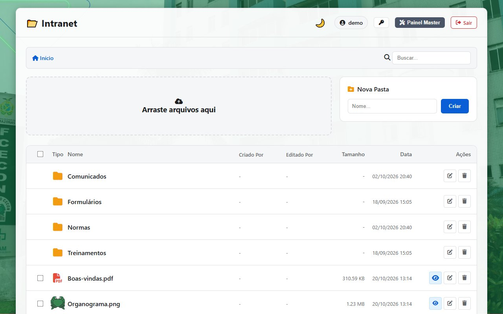
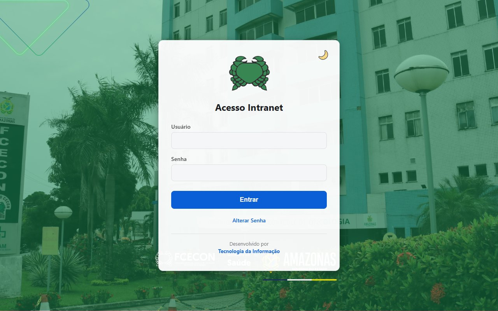
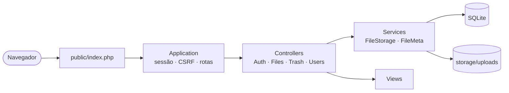

<div align="center">

# 📂 Intranet FCECON

**Gerenciador de arquivos da intranet da Fundação CECON.**
Login, pastas, upload, lixeira, auditoria e autoria de cada arquivo, em PHP puro com SQLite.

[](https://github.com/Fundacao-Cecon/intranet/actions/workflows/tests.yml)


[Início rápido](#-início-rápido) · [Configuração](#-configuração) · [Segurança](#-segurança) · [Testes](#-testes) · [Contribuindo](#-contribuindo) · [Documentação](#-documentação)

<br>

<picture>
  <source media="(prefers-color-scheme: dark)" srcset="docs/img/arquivos-dark.jpg">
  
</picture>

</div>

## 📁 Funcionalidades

- **Navegação e busca** por pastas, com **árvore lateral** (carrega sob demanda, teclado e leitor de tela) e visualização de imagens, PDF e vídeo no navegador.
- **Upload** por arrastar e soltar, criação de pastas e renomeação.
- **Download** de arquivos e de seleções inteiras em ZIP.
- **Lixeira** com restauração, exclusão definitiva e esvaziamento.
- **Acesso por pasta**: pastas restritas a usuários e grupos, com cadeado para quem não pode entrar.
- **Autoria**: cada item mostra quem criou e quem editou.
- **Auditoria**: Painel Master com o registro de quem fez o quê.
- **Tema claro e escuro**, que lembra a escolha de cada pessoa.

| Perfil | Pode |
|---|---|
| `user` | entrar, navegar, buscar, visualizar, baixar (inclusive ZIP) e trocar a própria senha |
| `admin` | tudo do `user`, mais upload, pastas, renomear, lixeira, usuários, grupos, acesso por pasta e logs |

Detalhes e regras de sessão em [usuarios-e-permissoes.md](docs/usuarios-e-permissoes.md).

## 🚀 Início rápido

Requer PHP 7.4 ou superior com as extensões `pdo_sqlite` e `zip` (`mbstring` recomendada).

```bash
git clone https://github.com/Fundacao-Cecon/intranet.git
cd intranet
```

Crie o primeiro administrador (a senha é pedida no prompt, nunca vai no comando):

```bash
php bin/create-user.php seu.login admin
```

Suba o servidor de desenvolvimento:

```bash
php -S localhost:8000 -t public
```

Abra <http://localhost:8000> e entre com o usuário criado.

> Para experimentar sem tocar nos dados reais, aponte para uma pasta de teste:
> `INTRANET_STORAGE=/caminho/teste php -S localhost:8000 -t public`

<picture>
  <source media="(prefers-color-scheme: dark)" srcset="docs/img/login-dark.jpg">
  
</picture>

## 🔧 Configuração

Em produção, o **docroot do site deve ser `public/`**. Nada fora dele pode ser acessível pela web.

| Variável | Efeito |
|---|---|
| `INTRANET_STORAGE` | Pasta de dados (padrão `./storage`); pode ficar em outro disco |
| `INTRANET_DEBUG=1` | Mostra erros na tela. **Nunca em produção** |
| `INTRANET_FORCE_HTTPS=1` | Use quando um proxy termina o HTTPS: cookie `Secure` e HSTS |
| `INTRANET_NEW_PASSWORD` | Senha lida pelo `bin/create-user.php` (uso não interativo) |

Scripts de operação:

| Comando | Para quê |
|---|---|
| `php bin/create-user.php <login> [admin\|user\|--reset]` | Criar usuário ou redefinir senha |
| `php bin/backup.php` | Backup do `storage/` com manifesto SHA-256 |
| `php bin/restore.php <backup> <destino>` | Restaurar em pasta nova |
| `php bin/smoke.php <url>` | Verificar o servidor publicado (docroot, cabeçalhos, cookies) |

Limites de upload, Apache, IIS, backup e diagnóstico estão em [operacao.md](docs/operacao.md).

## 🧱 Arquitetura



Camadas finas e sem framework ([ADR-0003](docs/decisoes/0003-sem-framework.md)). Views não acessam banco nem disco; Controllers não montam SQL nem caminhos na mão. Veja [arquitetura.md](docs/arquitetura.md).

<details>
<summary>Estrutura de pastas</summary>

```
public/    único diretório exposto na web (index.php + assets)
src/       código: Application, Controllers, Services, Views
config/    configuração (valores sensíveis vêm de variáveis de ambiente)
storage/   dados em runtime: uploads, lixeira, banco, logs (FORA do docroot)
bin/       scripts de linha de comando
tests/     suítes automatizadas
docs/      documentação e decisões de arquitetura (ADRs)
.github/   CI (GitHub Actions)
```

</details>

## 🔒 Segurança

- Dados em `storage/`, **fora do docroot**; arquivos nunca são servidos direto pelo servidor web ([ADR-0001](docs/decisoes/0001-docroot-public.md), [ADR-0002](docs/decisoes/0002-download-via-php.md)).
- Download só por `?action=download`, exige login, valida o caminho e usa lista branca de tipos para abrir no navegador (SVG e XML sempre baixam).
- **CSRF** obrigatório em todo POST.
- **Permissões por pasta** (usuários e grupos) checadas num ponto único, inclusive para download e ZIP ([ADR-0006](docs/decisoes/0006-permissoes-por-pasta.md)).
- Sessão com `HttpOnly`, `SameSite=Lax` e `Secure` em HTTPS; expira por inatividade e por tempo absoluto.
- Bloqueio temporário após falhas de login; endurecimento em andamento na [ADR-0005](docs/decisoes/0005-endurecimento-do-login.md).

Achados do code review e status de cada correção: [seguranca.md](docs/seguranca.md).

## 🧪 Testes

```bash
php tests/all.php                 # todas as suítes
php tests/all.php unit http       # só algumas
php tests/coverage.php --min=90   # cobertura de linhas (requer PCOV)
```

A suíte de JavaScript e acessibilidade (jsdom + axe-core) precisa de Node 18 ou superior e de uma instalação única:

```bash
cd tests/js && npm install
```

O CI roda tudo a cada push e Pull Request, mais cobertura e PHPStan (nível 5).

<details>
<summary>Matriz do CI</summary>

| Job | Ambiente |
|---|---|
| Suítes | PHP 7.4, 8.1, 8.3 e 8.4 no Ubuntu; PHP 8.3 no Windows |
| Cobertura | PHP 8.3 com PCOV, piso de 90% por arquivo crítico |
| Análise estática | PHPStan nível 5 |
| Arquivo grande | Manual (`workflow_dispatch`) |

</details>

Estratégia completa em [estrategia-de-testes.md](docs/estrategia-de-testes.md).

## 🤝 Contribuindo

O projeto usa **Git Flow**: `main` é a produção, `develop` é a integração.

```bash
git checkout develop && git pull
git checkout -b feature/nome-curto
```

Faça os commits no padrão [Conventional Commits](https://www.conventionalcommits.org/pt-br/) (`feat:`, `fix:`, `test:`, `docs:`), rode `php tests/all.php` e abra o Pull Request contra `develop`. Releases usam tags [SemVer](https://semver.org/lang/pt-BR/) (`vX.Y.Z`). Comandos de feature, release e hotfix em [git-flow.md](docs/git-flow.md).

## 📚 Documentação

| Documento | Conteúdo |
|---|---|
| [docs/README.md](docs/README.md) | Índice completo |
| [arquitetura.md](docs/arquitetura.md) | Camadas, fluxo de requisição e rotas |
| [fluxos.md](docs/fluxos.md) | Fluxos do login à ação final, com diagramas |
| [operacao.md](docs/operacao.md) | Instalação, servidor, backup e logs |
| [banco-de-dados.md](docs/banco-de-dados.md) | Tabelas e regras de migração |
| [decisoes/](docs/decisoes/) | ADRs: por que cada decisão foi tomada |
| [pendencias.md](docs/pendencias.md) | O que ainda não foi feito ou verificado |

<div align="center">
<sub>Mantido pela Tecnologia da Informação da Fundação CECON.</sub>
</div>
