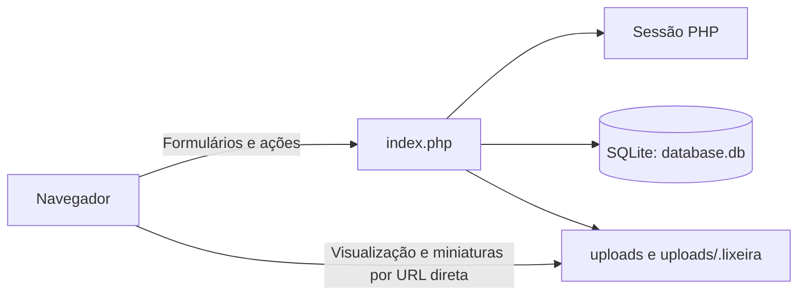
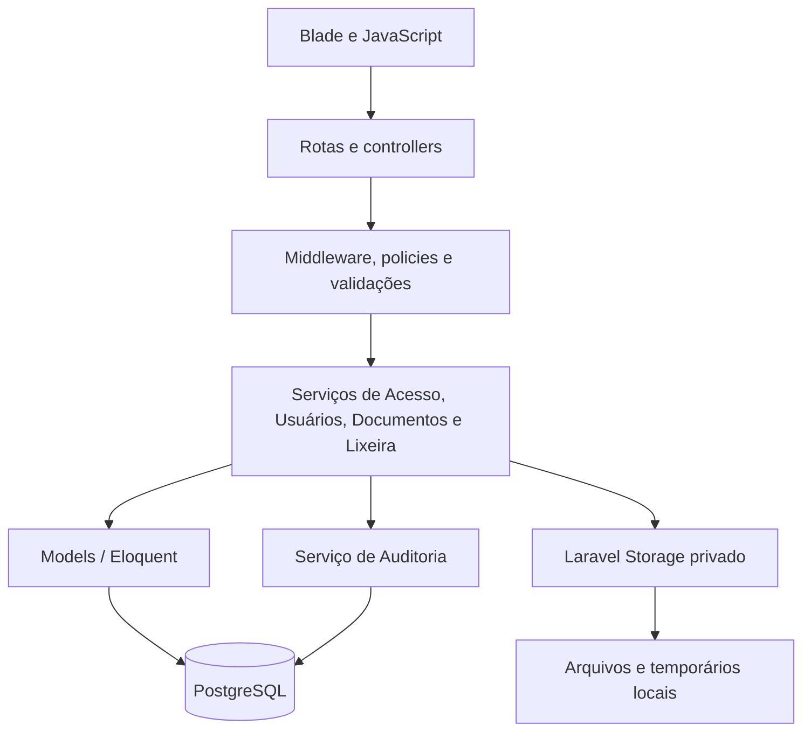
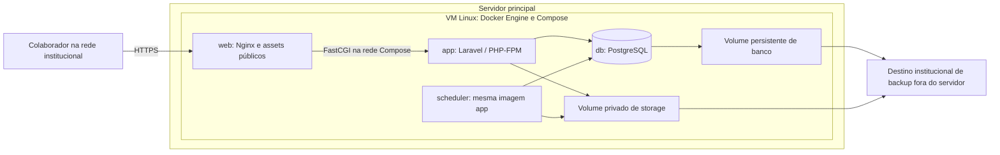
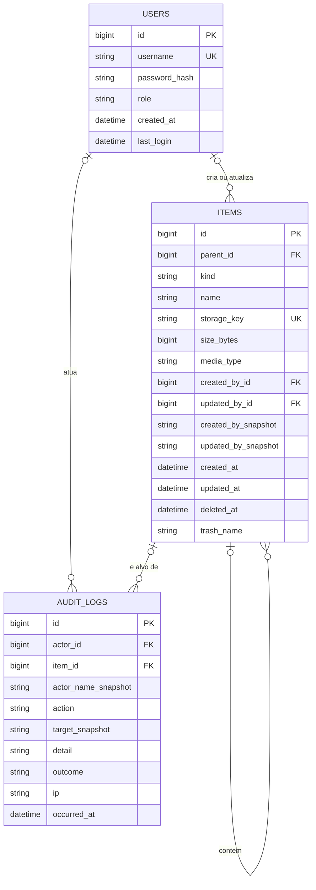
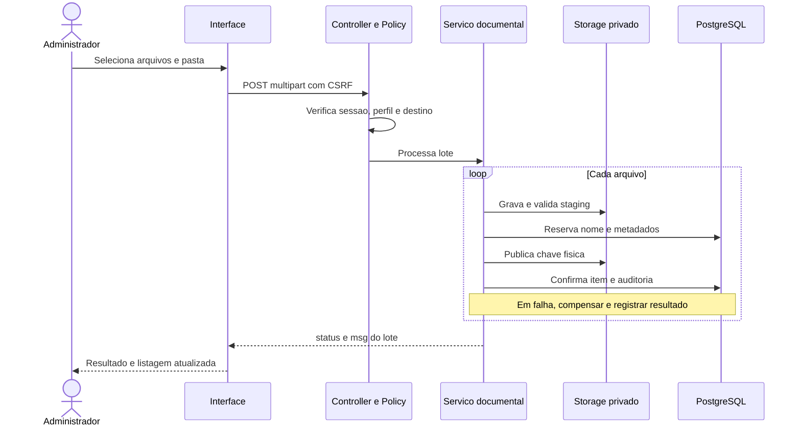
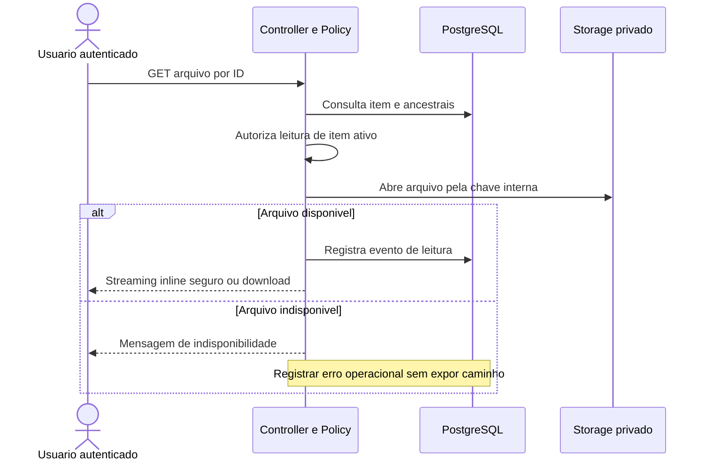

# Arquitetura da Intranet FCECON

**Data:** 14 de outubro de 2026  
**Público:** equipe de TI responsável pelo desenvolvimento, implantação e manutenção.  
**Status:** arquitetura proposta; a aplicação Laravel e a migração ainda não foram implementadas.

## 1. Objetivo e base de análise

Este documento descreve o sistema existente e define sua evolução para um monólito modular em **Laravel + PostgreSQL + Docker**, com armazenamento privado de documentos em volumes persistentes de uma VM Linux no servidor principal. As funcionalidades atuais e os perfis `user` e `admin` serão preservados.

A [modelagem dos fluxos](modelagem.md) complementa esta arquitetura com nove diagramas de usuário, API interna, banco e desenvolvimento/implantação. Ambos os documentos descrevem a solução futura; imagens, containers e aplicação ainda não foram implementados.

O [planejamento de tarefas e sprints](planejamento.md) organiza a implementação em 30 tarefas, seis ciclos de duas semanas e critérios de aceite vinculados aos requisitos deste documento. O primeiro marco é a demonstração de acesso e consulta ao final da Sprint 2.

A fonte é o [`index.php` no commit `72cc6bb`](https://github.com/Fundacao-Cecon/intranet/blob/72cc6bb44f21d6a99b817128581c3c820d085783/index.php). As definições das tabelas foram lidas no código; o conteúdo do banco SQLite e dos documentos institucionais não foi inspecionado. Não foram localizados documentos formais de problemática, solução, regras de negócio ou requisitos nas branches examinadas.

As informações são classificadas como **observadas** quando aparecem no código, **inferidas** quando descrevem a finalidade presumida do sistema e **propostas** quando definem a arquitetura futura. Inferências não substituem validação institucional. Esta entrega é documental: não altera a aplicação nem executa a migração.

## 2. Problemática e solução

### 2.1 Problemática de negócio — inferida

A instituição precisa disponibilizar documentos para seus colaboradores em um ponto central, organizar a consulta por pastas e controlar quem pode administrar esse acervo. A identificação de quem criou ou alterou um item e o registro das operações apoiam a rastreabilidade da manutenção documental.

O repositório contém documentos institucionais na pasta `Norma Zero`, o que sustenta a interpretação de um portal de distribuição documental. Não há evidência suficiente para afirmar que o sistema gerencia prontuários, aprova publicações ou controla versões de documentos.

### 2.2 Problemática técnica — observada

| Situação atual | Implicação arquitetural |
|---|---|
| PHP, HTML, CSS, JavaScript, autenticação e acesso a dados estão no mesmo arquivo. | Uma alteração pode afetar várias responsabilidades; os fluxos são difíceis de testar isoladamente. |
| Metadados são identificados pelo caminho do item. | Renomear pastas exige atualizar os caminhos dos descendentes; operações no disco e no banco podem divergir. |
| Visualizações e miniaturas usam URLs diretas de `uploads`. | A autorização dessas leituras não passa pelo controle de sessão do PHP; o bloqueio depende de configuração externa, não comprovada nesta análise. |
| Exclusão, restauração e exclusão de usuários são acionadas por GET. | Uma requisição de leitura pode provocar alteração de estado; não foi identificado controle CSRF. |
| O código cria tabelas e contas iniciais durante requisições. | Preparação do ambiente e execução da aplicação estão misturadas. |
| O repositório inclui `database.db` e documentos em `uploads`. | Código e dados operacionais têm ciclos de manutenção distintos e precisam de procedimentos próprios. |

### 2.3 Solução — existente e proposta

O sistema existente já oferece um portal autenticado para navegação, visualização e download, com administração de documentos, pastas, usuários e lixeira.

A evolução proposta preserva essa experiência, mas separa apresentação, controle de acesso, regras de aplicação e persistência. O Laravel fornece a estrutura web; o PostgreSQL registra usuários, hierarquia documental, metadados e auditoria; o armazenamento local privado guarda os arquivos. Toda leitura de documentos será autorizada pela aplicação.

**Sucesso esperado:** manter os fluxos atuais, impedir acesso indevido pelas rotas e pelas URLs de arquivos, preservar os documentos na migração e tornar as operações recuperáveis quando banco ou disco falharem.

## 3. Regras de negócio

As regras abaixo são **observadas**, com os ajustes de implementação futura identificados no texto.

| ID | Regra | Evidência no código |
|---|---|---|
| RN-01 | A interface principal exige usuário autenticado. | Verificação de sessão antes do painel. |
| RN-02 | Os perfis existentes são `user` e `admin`; usuários comuns consultam, visualizam e baixam documentos. | `$isAdmin` e controles do painel. |
| RN-03 | Apenas administradores criam pastas, enviam e renomeiam itens e os enviam à lixeira. | Blocos de ações protegidos por `$isAdmin`. |
| RN-04 | Apenas administradores criam, listam e excluem usuários e consultam os logs administrativos. | Painel Master e ações de usuários. |
| RN-05 | O administrador não pode excluir a própria conta. | Comparação com `$_SESSION['user_id']`. |
| RN-06 | A troca de senha exige usuário e senha atual válidos. | `change_pwd_public` e `password_verify`. |
| RN-07 | O upload aceita múltiplos arquivos e filtra extensões pela lista permitida. | `$extensoesPermitidas` e processamento de `arquivos[]`. |
| RN-08 | Uploads com nome existente recebem sufixo numérico; não substituem o arquivo anterior. | `renomearSeExistir`. |
| RN-09 | Criar pasta com nome vazio/inválido ou já existente é recusado. | Ação `nova_pasta` e `limparNome`. |
| RN-10 | Renomear preserva a extensão de arquivos e recusa um destino já existente. | Ação `rename_item`. |
| RN-11 | Excluir arquivo ou pasta primeiro envia o item à lixeira. | Ação `deletar`. |
| RN-12 | Apenas administradores restauram, excluem permanentemente ou esvaziam a lixeira. | `$vendoLixeira` e ações de lixeira. |
| RN-13 | A restauração devolve o item à raiz, com sufixo se o nome já existir. | Ação `restore`; não restaura a pasta de origem. |
| RN-14 | O ZIP reúne arquivos selecionados da pasta atual; não inclui pastas recursivamente. | Ação `baixar_zip`, teste `is_file` e `ZipArchive`. |
| RN-15 | A busca filtra nomes dos itens da pasta atual, sem diferenciar maiúsculas e minúsculas. | `filtrarArquivos`; não há pesquisa global ou no conteúdo. |
| RN-16 | Metadados identificam criação e atualização quando disponíveis; autoria ausente aparece como `-`. | `files_meta`, funções de metadados e listagem. |
| RN-17 | O sistema registra operações como login, senha, upload, bloqueio, download, ZIP e ações administrativas. | `registrarLog` e consultas da tabela `logs`. |

A proposta mantém a troca de senha a partir da tela de login mediante comprovação da senha atual; isso não constitui recuperação por e-mail. A interface autenticada também disponibilizará essa operação aos dois perfis.

## 4. Requisitos e rastreabilidade

### 4.1 Requisitos funcionais — derivados do código

Os casos CA são definidos na seção 10. Cada requisito abaixo deve ser validado na futura implementação.

| ID | Capacidade | Módulo | Regras | Aceitação |
|---|---|---|---|---|
| RF-01 | Autenticar, encerrar sessão e registrar último login. | Acesso | RN-01, RN-02, RN-17 | CA-01 |
| RF-02 | Alterar senha comprovando a senha atual. | Acesso | RN-06, RN-17 | CA-02 |
| RF-03 | Criar, listar e excluir usuários com os dois perfis existentes. | Usuários | RN-04, RN-05 | CA-03 |
| RF-04 | Navegar por pastas com breadcrumbs e filtrar nomes na pasta atual. | Documentos e Pastas | RN-02, RN-15 | CA-04 |
| RF-05 | Visualizar formatos suportados e baixar os demais. | Documentos e Pastas | RN-02 | CA-05 |
| RF-06 | Baixar arquivo individual ou arquivos selecionados em ZIP. | Documentos e Pastas | RN-02, RN-14, RN-17 | CA-06 |
| RF-07 | Enviar múltiplos arquivos com retorno de progresso e resultado. | Documentos e Pastas | RN-03, RN-07, RN-08 | CA-07 |
| RF-08 | Criar pastas e renomear arquivos ou pastas. | Documentos e Pastas | RN-03, RN-09, RN-10 | CA-08 |
| RF-09 | Enviar arquivos e pastas à lixeira. | Lixeira | RN-03, RN-11 | CA-09 |
| RF-10 | Listar a lixeira, restaurar para a raiz, excluir permanentemente e esvaziar. | Lixeira | RN-12, RN-13 | CA-09, CA-10 |
| RF-11 | Exibir autoria, tamanho e data dos itens, sem inventar dados ausentes. | Documentos e Pastas | RN-16 | CA-11 |
| RF-12 | Registrar e consultar auditoria administrativa. | Auditoria | RN-04, RN-17 | CA-12 |
| RF-13 | Preservar interface em português, tema claro/escuro e adaptação básica a telas menores. | Apresentação | Comportamento observado na interface | CA-15 |

A visualização atual cobre imagens raster, PDF, MP4 e TXT; outros formatos são baixados. A interface de upload mostra o progresso de envio dos bytes, que não deve ser confundido com a conclusão do processamento no servidor.

### 4.2 Requisitos não funcionais — propostos

| ID | Requisito | Decisão arquitetural | Aceitação |
|---|---|---|---|
| RNF-01 | Autorizar todas as operações no servidor. | Middleware de sessão e policies por ação; a interface não é a fronteira de segurança. | CA-01, CA-03, CA-09 |
| RNF-02 | Proteger documentos, lixeira e dados operacionais contra acesso direto. | Storage privado e raiz web limitada ao diretório público da aplicação. | CA-05 |
| RNF-03 | Proteger sessões, credenciais e operações de alteração. | HTTPS interno, hash de senha, regeneração de sessão no login, CSRF e limitação de tentativas de autenticação. | CA-01, CA-02, CA-13 |
| RNF-04 | Evitar divergência silenciosa entre banco e disco. | IDs estáveis, staging de upload, compensação e reconciliação de operações interrompidas. | CA-07, CA-08, CA-10, CA-13 |
| RNF-05 | Facilitar manutenção e testes por responsabilidade. | Controllers pequenos, serviços de aplicação, policies, models e views separados. | Revisão estrutural e suíte por módulo |
| RNF-06 | Permitir recuperação conjunta de banco e documentos. | Backup coordenado, manifesto de arquivos e ensaio de restauração. | CA-14 |
| RNF-07 | Operar em um servidor acessível pela rede institucional. | Aplicação, PostgreSQL e storage local; dependências visuais servidas localmente. | CA-15 |
| RNF-08 | Limitar consumo de recursos e tratar falhas de entrada. | Limites configuráveis de upload/ZIP, streaming, temporários exclusivos e validação de arquivos. | CA-07, CA-13 |
| RNF-09 | Sustentar rastreabilidade sem expor segredos. | Eventos com ator, ação, alvo, resultado e horário; senhas e conteúdo dos documentos não entram nos logs. | CA-12 |
| RNF-10 | Reproduzir o ambiente local e implantar imagens versionadas na VM Linux. | Docker e Compose; build local, teste das imagens finais, exportação por arquivo, importação sem build na VM e volumes persistentes. | CA-16, CA-17, CA-18, CA-19 |

Não há medições que permitam estabelecer número de usuários simultâneos, SLA, tempo máximo de resposta, RPO ou RTO. Esses valores devem ser definidos pela TI antes da homologação operacional; não são garantias desta proposta.

## 5. Arquitetura existente

| Elemento | Responsabilidade observada |
|---|---|
| `index.php` | Inicialização, autenticação, regras, SQL, operações no disco e interface. |
| Sessão PHP | Nome, perfil e ID do usuário autenticado. |
| `users` | Login, hash de senha, perfil, criação e último acesso. |
| `logs` | Data/hora, IP, nome do usuário, ação e detalhe. |
| `files_meta` | Caminho relativo, nomes dos autores e datas de criação/atualização. |
| `uploads` | Estrutura física de pastas e arquivos disponíveis. |
| `uploads/.lixeira` | Itens removidos da área principal, com nomes ajustados para colisões. |

O servidor web, o sistema operacional e a configuração real de implantação não constam da base analisada. O `.htaccess` gerado impede listagem e certas extensões executáveis em ambientes compatíveis, mas não estabelece autenticação para todos os documentos.

## 6. Arquitetura futura

### 6.1 Estilo e módulos

Adotar **monólito modular**: uma aplicação Laravel, uma implantação e um banco PostgreSQL. A interface será renderizada em Blade, com JavaScript para filtro local, seleção, modais, tema e upload. Não haverá SPA, API pública, microsserviços ou serviço externo de armazenamento nesta versão.

| Módulo | Responsabilidade | Dependências |
|---|---|---|
| Acesso | Login, logout, sessão, troca de senha e último acesso. | Usuários e Auditoria |
| Usuários | Cadastro, listagem, exclusão e validação dos perfis. | Policies e Auditoria |
| Documentos e Pastas | Navegação, filtro, upload, renomeação, metadados, visualização, download e ZIP. | Policies, Eloquent, Storage e Auditoria |
| Lixeira | Exclusão lógica, listagem, restauração e remoção permanente. | Documentos e Pastas, Storage e Auditoria |
| Auditoria | Registro e consulta de eventos. | PostgreSQL; não executa operações de negócio |

Os controllers coordenam HTTP; as validações conferem as entradas; as policies autorizam; os serviços executam os casos de uso; os models persistem os dados. Views não contêm SQL nem regras de permissão exclusivas. O serviço de lixeira reutiliza o modelo documental, evitando uma segunda implementação de arquivos.

### 6.2 Tecnologias e implantação

Usar Laravel 13, PHP 8.4 com PHP-FPM, Nginx, Composer, extensão `pdo_pgsql`, Fileinfo e suporte a ZIP. PHP 8.4 está entre as versões suportadas pelo Laravel 13. PostgreSQL será acessado por `pgsql`, com migrations para evolução do esquema. Fontes: [versões do Laravel](https://github.com/laravel/docs/blob/13.x/releases.md), [implantação](https://github.com/laravel/docs/blob/13.x/deployment.md) e [conexões de banco](https://github.com/laravel/docs/blob/13.x/database.md).

Docker será usado no desenvolvimento local e na implantação. No computador Windows, a referência é Docker Desktop com WSL2 e containers Linux; na VM Linux, Docker Engine e plugin Compose. A plataforma de imagem de referência é `linux/amd64`, sujeita à confirmação da arquitetura da VM antes do build real. Não é necessário instalar PHP, Composer ou Node diretamente na VM de produção.

A raiz publicada será somente `public`; documentos, banco, configuração e temporários ficam fora dela. O PostgreSQL não será exposto aos computadores dos colaboradores. Credenciais serão configuradas por ambiente, sem contas ou senhas fixas no código. O usuário de execução terá privilégios de dados; migrações usarão credenciais com permissão de alteração de esquema.

A implantação futura usará Nginx em container e VM Linux. O ambiente legado ainda precisa ser inventariado para a migração. Somente o serviço `web` publicará portas na VM; o banco e o PHP-FPM serão acessíveis apenas pela rede privada do Compose. A configuração de HTTPS e os certificados serão fornecidos na implantação.

Sessões e cache usarão arquivos locais privados no volume de storage inicialmente. Uploads e ZIP serão síncronos, com streaming e limites alinhados ao servidor; não serão introduzidos Redis ou workers de filas nesta versão. Um único serviço `scheduler`, reutilizando a imagem da aplicação, executará o agendamento de reconciliação com acesso ao mesmo banco e storage. A geração de assets ocorrerá no processo de build, sem dependência de CDN para uso cotidiano.

### 6.3 Controle de acesso e interfaces HTTP

| Operação | Visitante | `user` | `admin` |
|---|---|---|---|
| Login e troca de senha com comprovação da senha atual | Sim | Sim | Sim |
| Navegação, filtro, visualização, download e ZIP de itens ativos | Não | Sim | Sim |
| Upload, criação de pasta e renomeação | Não | Não | Sim |
| Exclusão lógica e administração da lixeira | Não | Não | Sim |
| Gestão de usuários e consulta dos logs | Não | Não | Sim |

Rotas futuras usarão IDs, em vez de aceitar caminhos físicos enviados pelo navegador. A identificação de um item não dispensa a verificação de seu estado e de seus ancestrais: descendentes de uma pasta na lixeira também não podem ser consultados na área ativa.

| Interface proposta | Método | Contrato principal |
|---|---|---|
| `/login`, `/senha` | GET / POST | Formulário e envio de credenciais; `/senha` exige usuário, senha atual e nova senha. |
| `/logout` | POST | Encerra a sessão e invalida o token correspondente. |
| `/documentos` | GET | Lista raiz ou pasta por ID, com pastas primeiro e ordenação natural sem diferenciar caixa. |
| `/documentos/upload` | POST | Multipart com `arquivos[]` e pasta de destino por ID. |
| `/pastas` | POST | Nome e pasta pai; cria somente com permissão administrativa. |
| `/itens/{id}` | PATCH / DELETE | Renomeia ou envia à lixeira. |
| `/arquivos/{id}/visualizar`, `/arquivos/{id}/download` | GET | Streaming autorizado de arquivo ativo. |
| `/documentos/zip` | POST | IDs de arquivos da pasta atual; produz ZIP temporário privado. |
| `/lixeira` | GET | Lista itens removidos, somente para administradores. |
| `/lixeira/{id}/restaurar` | POST | Restaura na raiz com resolução de colisões. |
| `/lixeira/{id}`, `/lixeira` | DELETE | Exclui permanentemente um item ou esvazia após confirmação. |
| `/usuarios`, `/usuarios/{id}` | GET / POST / DELETE | Lista, cria ou exclui usuários; bloqueia autoexclusão. |
| `/auditoria` | GET | Consulta os 50 eventos mais recentes, como no painel atual. |

Todos os envios de formulários terão CSRF, inclusive login, senha e ZIP. Leituras GET podem registrar auditoria, mas não alteram documentos, contas ou estado de lixeira. Formulários HTML usarão o mecanismo de method spoofing do Laravel para PATCH e DELETE.

O upload AJAX manterá as chaves `status` e `msg` de retorno, com sucesso ou advertência para lotes parcialmente processados. Cada arquivo será tratado individualmente, preservando a possibilidade de alguns serem aceitos e outros recusados. Erros de validação, permissão e infraestrutura terão mensagens em português, sem revelar caminhos internos ou detalhes de exceções.

Os formatos permitidos inicialmente serão os da lista existente. A validação verificará extensão, erro de upload, tamanho e tipo detectado quando aplicável; conteúdo ativo não será servido inline. Formatos sem visualização segura serão entregues como download. O limite declarado no PHP atual não prova o limite efetivo do servidor nem constitui um requisito institucional de 2 GB.

### 6.4 Docker: serviços, volumes e configuração

| Serviço | Imagem e execução | Persistência e acesso |
|---|---|---|
| `web` | Imagem própria baseada em Nginx, com assets de `public` da mesma revisão da aplicação. | Somente entrada HTTP/HTTPS; sem montagem do acervo. Certificados montados como leitura. |
| `app` | Imagem Laravel/PHP-FPM com código e dependências de execução. | Volume privado de storage; acesso ao banco por nome de serviço `db`. |
| `db` | Imagem oficial PostgreSQL com versão fixada no manifesto da entrega. | Volume de dados compatível com a versão escolhida; sem porta publicada na rede institucional. |
| `scheduler` | Mesma imagem/tag de `app`, com comando de agendamento em lugar do PHP-FPM. | Compartilha storage e configuração da aplicação; uma única instância. Não é worker de fila. |

Usar volumes nomeados estáveis, distintos entre desenvolvimento, testes e produção, para banco e storage. O storage conterá documentos, sessões, cache, staging, quarentena, temporários e manifestos operacionais. `bootstrap/cache` será gravável por container e regenerado com a configuração do ambiente, sem transportar cache de configuração local para produção.

Aplicação e scheduler usarão identidades e permissões compatíveis para o storage compartilhado. O serviço web verá apenas assets públicos e encaminhará PHP ao serviço app; documentos privados nunca serão publicados como arquivos estáticos.

Separar três categorias:

- **Imagens:** código, dependências de execução e assets compilados, identificados por versão e commit.
- **Configuração:** parâmetros de ambiente, segredos e certificados provisionados separadamente. A `APP_KEY` deve permanecer estável entre recriações; não será gerada a cada inicialização.
- **Dados:** banco, documentos e estado operacional nos volumes. A atualização de imagens não substitui nem recria esses volumes.

Não armazenar senhas, `.env`, banco, documentos ou backups em camadas da imagem. Logs operacionais irão para stdout/stderr com rotação configurada; a auditoria continuará no PostgreSQL. Volumes não substituem backup, e comandos de atualização não devem remover volumes. Referência: [volumes Docker](https://docs.docker.com/engine/storage/volumes/).

### 6.5 Desenvolvimento, build e distribuição por arquivo

A futura implementação terá configuração Compose base, complemento de desenvolvimento e complemento de produção, carregados explicitamente. Apenas desenvolvimento montará o código do computador; dependências Composer e Node terão armazenamento próprio no ambiente de desenvolvimento para não serem ocultadas pela montagem. Produção executará o código incluído nas imagens. Referência: [Compose em produção](https://docs.docker.com/compose/how-tos/production/).

Um Dockerfile com etapas distintas organizará dependências Composer, compilação de assets, ferramentas de desenvolvimento e imagens finais de aplicação/web. As duas imagens finais serão construídas a partir do mesmo commit e testadas localmente sem montagem do código. Dependências de desenvolvimento e ferramentas de build não serão necessárias na execução da VM. `.dockerignore` excluirá segredos, dados operacionais, backups e artefatos locais do contexto. Referência: [build em múltiplas etapas](https://docs.docker.com/build/building/multi-stage/).

O pacote de entrega conterá:

1. Arquivo `.tar` com todas as imagens necessárias: aplicação, web e PostgreSQL. O scheduler reutiliza a imagem app.
2. Configuração Compose de produção, sem build e com pull desabilitado, e instruções de operação.
3. Manifesto de versão/commit, plataforma, tags fixadas e IDs das imagens, além do checksum SHA-256 do arquivo.

Exportar com `docker image save`, transferir o pacote e importar com `docker image load`. O mesmo artefato validado localmente será usado na VM. A operação na VM não depende de registry, compilação de assets ou instalação Composer; Docker/Compose devem estar previamente provisionados. Não usar `docker export/import`, que exportam filesystem de container em vez da entrega de imagens. Fontes: [save](https://docs.docker.com/reference/cli/docker/image/save/) e [load](https://docs.docker.com/reference/cli/docker/image/load/).

Build exige acesso às fontes de dependências no computador de desenvolvimento. Na VM, verificar checksum, plataforma e presença de todas as imagens antes de alterar os serviços. Credenciais e certificados não integram o arquivo de imagens. O fluxo completo de entrega e retorno está na [modelagem de desenvolvimento](modelagem.md#5-fluxo-de-desenvolvimento).

## 7. Dados e armazenamento

### 7.1 Modelo lógico proposto

O PostgreSQL armazenará a hierarquia lógica. O disco armazenará os bytes em chaves independentes dos nomes visíveis. Pastas serão entidades lógicas: renomeá-las não exigirá mover fisicamente todos os arquivos.

| Entidade | Política de dados |
|---|---|
| `users` | Login único; perfil limitado a `user` ou `admin`; hash de senha, nunca senha aberta. |
| `items` | `kind` distingue arquivo e pasta; `parent_id` nulo indica raiz; `storage_key` é nula em pastas. Autoria e datas históricas desconhecidas podem permanecer nulas. |
| `audit_logs` | Ator e item podem ser nulos após exclusão; snapshots textuais mantêm o significado do evento. Dados herdados conservam o detalhe original e não recebem resultado presumido. |

Excluir usuário não exclui seus documentos nem logs: referências de autoria ficam nulas, preservando snapshots históricos quando existirem. A exclusão permanente de uma pasta é feita pelo serviço, cobrindo seus descendentes; não se delega a remoção dos arquivos físicos a um cascade SQL.

Definir constraints para tipos de item e perfis, chaves estrangeiras e unicidade dos nomes ativos por pasta, incluindo explicitamente o caso da raiz. A equivalência de nomes continuará sensível à caixa, como nas verificações atuais de SQLite e disco em ambientes sensíveis à caixa; colisões oriundas de outro ambiente serão relatadas no inventário. Bloquear a criação de ciclos na hierarquia.

Indexar `parent_id` para navegação e as referências de usuário/item usadas em consultas e exclusões. Considerar índices parciais para consultas recorrentes a itens ativos e removidos, e ordenar auditoria por ID decrescente. Validar os planos de consulta com dados representativos, sem criar índices para toda coluna. Referências: [constraints do PostgreSQL](https://www.postgresql.org/docs/current/ddl-constraints.html) e [índices parciais](https://www.postgresql.org/docs/current/indexes-partial.html).

### 7.2 Identidade, lixeira e integridade

O disco privado usará uma chave interna gerada pela aplicação para cada arquivo. Nome, pasta e caminho de apresentação são metadados. Criar pastas, renomear e enviar à lixeira serão operações de banco, sem alteração da chave física. Usar o driver local privado do Laravel, sem publicar symlink do acervo. Referência: [filesystem do Laravel](https://github.com/laravel/docs/blob/13.x/filesystem.md).

A exclusão lógica marca a raiz removida com `deleted_at`. Seus descendentes permanecem vinculados à hierarquia e são inacessíveis enquanto qualquer ancestral estiver removido. O nome exibido na lixeira (`trash_name`) seguirá a resolução de colisões do comportamento atual. Restaurar limpa o estado de remoção, usa esse nome como base, resolve colisões na raiz e mantém os descendentes vinculados à pasta restaurada.

Uma transação SQL não engloba o filesystem. O serviço utilizará as seguintes estratégias:

- **Upload:** gravar em staging privado, validar, reservar ID e nome e publicar o arquivo na chave final; só listar o item após a conclusão. Falha deve remover o staging/arquivo criado e reverter os metadados ainda não concluídos. Concorrência na escolha do nome será resolvida por constraint e nova tentativa de sufixo.
- **Renomeação e lixeira:** alterar metadados e registrar auditoria na mesma transação; os bytes continuam na chave estável. Bloquear a pasta de destino durante operações concorrentes de nomes, incluindo uma trava compartilhada para a raiz lógica.
- **Exclusão permanente:** registrar um manifesto operacional durável em área privada, com ID da operação e arquivos envolvidos; mover os bytes para quarentena privada reversível, confirmar a remoção dos metadados e depois limpar a quarentena. Falha anterior ao commit restaura os bytes; falha posterior mantém a limpeza pendente para repetição.
- **Reconciliação:** executar rotina agendada local que examine staging e manifestos interrompidos e conclua ou compense a operação. Verificar o resultado no PostgreSQL antes de remover qualquer arquivo. Uma operação só é anunciada como concluída quando atinge seu estado final; falhas e limpeza pendente são registradas.

Os manifestos não são documentos do acervo e nunca serão expostos pela interface. Em esvaziamento de lixeira, o serviço processa cada raiz removida separadamente e informa falhas parciais, sem anunciar sucesso integral quando restam itens.

## 8. Fluxos principais

### 8.1 Upload múltiplo

O progresso mostra a transmissão; a confirmação vem da resposta final. A validação também impede publicar em uma pasta removida durante o envio. Uma interrupção abrupta é tratada pela reconciliação, não por uma promessa de atomicidade entre disco e SQL.

### 8.2 Visualização e download

Downloads terão nome de apresentação apropriado e cabeçalhos seguros. Uma tentativa sem sessão ou contra item na lixeira não abrirá os bytes. ZIP usará um temporário exclusivo por requisição, autorização de cada item e limpeza após a resposta ou por reconciliação em caso de interrupção.

## 9. Migração, implantação e recuperação

### 9.1 Preparação e ensaio

1. Inventariar ambiente PHP/web, volume do acervo, espaço livre, permissões, timezone do legado e formatos utilizados. Registrar limites de upload, ZIP e concorrência para homologação.
2. Preparar ambiente Docker separado com Laravel, PostgreSQL, storage privado, HTTPS e migrations. Não conectar testes ao banco ou storage de produção.
3. Criar uma cópia consistente do SQLite e do acervo, incluindo lixeira. Gerar manifesto com caminho, tamanho, hash SHA-256 e estado ativo/removido.
4. Importar usuários com IDs mapeados e hashes compatíveis com a configuração de autenticação. Hash incompatível exige tratamento explícito antes do corte; nenhuma conta recebe senha padrão compartilhada.
5. Criar a hierarquia a partir do disco; mapear `files_meta` por caminho, gerar chaves físicas e copiar bytes. Preservar a lixeira e seus nomes. Autorias não resolvidas conservam o texto histórico e vínculo nulo; autoria ausente não é atribuída ao importador.
6. Importar logs com o texto e horário originais. O legado mistura timestamps de banco e horário local: determinar sua interpretação com a TI, registrando ambiguidades antes da conversão, sem inventar precisão temporal.
7. Comparar quantidades, tamanhos e hashes, além das relações pai/filho, perfis e autoria. Entradas de metadados sem arquivo, arquivos sem metadados, nomes conflitantes e referências ambíguas entram em relatório de reconciliação.
8. Executar os casos CA-01 a CA-19 e um ensaio de restauração. O importador precisa poder repetir o ensaio sem duplicar itens ou logs, usando o mapeamento persistente da origem.

### 9.2 Corte e retorno

Em janela de manutenção, bloquear gravações no legado, realizar backup final consistente e repetir a importação validada. Só liberar o Laravel após conferir o manifesto e os fluxos essenciais. Preservar o ambiente anterior isolado e sem gravações concorrentes.

Na VM, importar as imagens antes do corte, validar a configuração e obter backup de banco/storage antes de migrations. Executar migrations explicitamente em um container temporário da mesma imagem app, com credenciais adequadas; não executá-las automaticamente no entrypoint de cada serviço. Na primeira implantação, provisionar banco e volumes antes desse comando. Aplicação e scheduler só entrarão em operação normal após as migrations e verificações de integridade.

Usar políticas de reinício e healthchecks para web, aplicação e banco. A prontidão requer banco acessível e storage gravável; a disponibilidade do processo isolado não basta. Verificar a execução do scheduler por registro de última execução da rotina. Não expor detalhes desses diagnósticos aos usuários.

Se o corte falhar antes da liberação, retornar ao legado com seu backup consistente. Se falhar após novas gravações no Laravel, suspender gravações, preservar os novos dados e reconciliar as alterações antes do retorno; simplesmente restaurar um backup antigo perderia operações realizadas após o corte.

Nas atualizações do sistema containerizado, guardar imagens e manifesto da versão anterior. Trocar imagens não reverte migrations nem dados: avaliar a compatibilidade da versão anterior com o esquema atual antes de reiniciar. Se houver incompatibilidade, ensaiar restauração/reconciliação do banco e acervo como conjunto. A preservação dos volumes vale durante atualização e retorno.

### 9.3 Backup e operação

Backups incluirão PostgreSQL, storage, manifestos operacionais relevantes e configuração necessária à recuperação, com segredos protegidos. Para a primeira versão, coordenar o snapshot em manutenção curta sem gravações, com operações em andamento concluídas ou registradas. Usar dump do PostgreSQL e cópia verificada do acervo; o dump sozinho não contém os arquivos. Referência: [backup por SQL dump](https://www.postgresql.org/docs/current/backup-dump.html).

Guardar cópia fora do servidor principal, em destino institucional com acesso restrito. Frequência, retenção, RPO e RTO serão definidos pela TI. Toda rotina deverá informar sucesso/falha e a data do último backup restaurado em ensaio.

Monitorar disponibilidade HTTP, conexão com PostgreSQL, espaço livre, falhas de upload/download, erros de aplicação e pendências de reconciliação. Usar `APP_DEBUG=false` em produção. Detalhes operacionais ficam nos logs internos, separados da auditoria de negócio.

## 10. Cenários de teste e critérios de aceitação

Os cenários abaixo são especificações para a implementação futura; não representam testes da aplicação executados nesta entrega documental. Testes de concorrência, constraints e migração usarão PostgreSQL real em ambiente isolado, além de storage temporário para testes de arquivo.

| ID | Cenário e resultado esperado |
|---|---|
| CA-01 | Login válido atualiza último acesso e regenera sessão; login inválido não cria sessão; logout invalida acesso. Visitante não lista documentos e `user` recebe recusa em rotas administrativas diretas. |
| CA-02 | Ambos os perfis alteram a própria senha com a senha atual correta; senha incorreta não altera o hash; comprovação é exigida também no formulário anterior ao login. |
| CA-03 | Admin cria/lista/exclui usuários; login duplicado e perfil desconhecido são recusados; autoexclusão é bloqueada; excluir outra conta preserva documentos e histórico. |
| CA-04 | Navegação e breadcrumbs refletem a hierarquia; filtro ignora caixa e atua somente na pasta atual; pastas precedem arquivos; destino inexistente ou removido não é navegável. |
| CA-05 | Formatos previstos são visualizados ou baixados; acesso sem sessão, URL direta do storage, ID de item removido e descendente de pasta removida não entregam bytes. |
| CA-06 | Download mantém bytes e nome; ZIP inclui apenas arquivos selecionados da pasta atual, sem pastas recursivas; requisições simultâneas não compartilham temporários. |
| CA-07 | Upload múltiplo trata sucesso parcial, extensão inválida, erro de transmissão e limite excedido; nomes repetidos recebem sufixos, inclusive sob concorrência; não há item listado antes de concluir o armazenamento. |
| CA-08 | Criar pasta duplicada/vazia é recusado; renomear preserva extensão e recusa colisão; renomear pasta não perde filhos nem autoria e mantém IDs estáveis. |
| CA-09 | Exclusão lógica oculta o item e seus descendentes; apenas admin opera a lixeira; restauração vai à raiz, mantém os descendentes e resolve colisões. |
| CA-10 | Exclusão permanente e esvaziamento removem itens e bytes previstos; falhas antes/depois do commit são compensadas ou concluídas pela reconciliação; falha parcial não é anunciada como sucesso integral. |
| CA-11 | Listagem exibe tamanho, datas e autores disponíveis; dados legados ausentes permanecem ausentes; identidade e autoria não mudam indevidamente após renomear/restaurar. |
| CA-12 | Operações registram ator, ação, alvo e resultado; logs mantêm significado após exclusões; apenas admin consulta a auditoria; senhas e conteúdo documental não aparecem nos eventos. |
| CA-13 | CSRF ausente/inválido é recusado; GET não altera acervo/contas/lixeira; entrada com traversal não acessa caminhos externos; banco indisponível, disco cheio e interrupção não deixam falhas silenciosas. |
| CA-14 | Importação repetida não duplica dados; manifesto confirma documentos ativos e removidos; backup restaurado recupera relações e bytes; ensaio de retorno inclui alterações posteriores ao corte. |
| CA-15 | Fluxos essenciais funcionam na rede interna sem CDN; tema persiste; telas de login, consulta e administração permanecem utilizáveis em desktop e tela menor; limites operacionais definidos são homologados. |
| CA-16 | Ambiente Docker local inicia os serviços previstos; edição do código é refletida em desenvolvimento; os ambientes de teste e produção não compartilham dados locais. |
| CA-17 | As imagens finais passam por teste sem montagem do código; pacote contém todas as imagens; checksum e plataforma são verificados; importação em VM limpa inicia o sistema sem build ou acesso a registry, usando configuração e segredos provisionados. |
| CA-18 | Recriar containers e atualizar imagens preserva banco, documentos, sessões e manifestos; APP_KEY permanece estável; imagens não contêm segredos nem dados operacionais. |
| CA-19 | Healthchecks e scheduler funcionam; migrations são explícitas e posteriores ao backup; apenas web publica portas; retorno usa imagens anteriores e verifica compatibilidade de esquema sem descartar dados. |

A revisão documental deve confirmar que cada RN/RF/RNF possui decisão ou comportamento correspondente e que os diagramas usam os mesmos módulos e entidades descritos no texto. A aprovação operacional exige inventário e resultados do ensaio de migração, não apenas a existência deste documento.

## 11. Premissas, limites e decisões

| Decisão | Motivo e consequência |
|---|---|
| Laravel com Blade e JavaScript | Estruturar a aplicação PHP e preservar a interação atual sem introduzir uma aplicação frontend separada. |
| PostgreSQL | Escolha definida para a evolução; demanda provisionamento, importação do SQLite e operação de backup própria. |
| Docker e Compose em desenvolvimento e produção | Padronizar execução e levar o mesmo artefato de produção validado localmente para a VM. |
| VM Linux no servidor principal e volumes privados locais | Escolha definida para hospedagem; simplifica a implantação, mas mantém um ponto único de falha. Backup externo não representa alta disponibilidade. |
| Distribuição por arquivo de imagens | Exportar/importar a entrega sem registry; configuração, segredos e dados são provisionados separadamente. |
| IDs e hierarquia lógica | Separar identidade de nome/caminho e reduzir operações físicas durante renomeações e lixeira. |
| Dois perfis e funcionalidades atuais | Evitar ampliar o processo institucional sem requisitos específicos. |
| Regras de colisão e restauração para a raiz | Manter o comportamento observado em vez de introduzir restauração automática para a origem. |

Ficam fora desta versão: aprovação de publicação, versionamento documental, permissões por setor, SSO, recuperação por e-mail, pesquisa global/no conteúdo, edição online, integrações externas e alta disponibilidade.

Permanecem como parâmetros operacionais a definir pela TI: distribuição Linux, arquitetura da CPU e recursos da VM, versões exatas das imagens base, domínio/certificados, volume e crescimento do acervo, concorrência esperada, limites de tamanho e lote, orçamento de temporários, frequência/retenção de backup, SLA, RPO e RTO. A interpretação dos horários legados também depende do inventário. Essas lacunas não são preenchidas com valores arbitrários.

A arquitetura futura só será considerada implantada após desenvolvimento, migração ensaiada e homologação. Este documento fornece sua base técnica e a rastreabilidade dos requisitos derivados do código.
