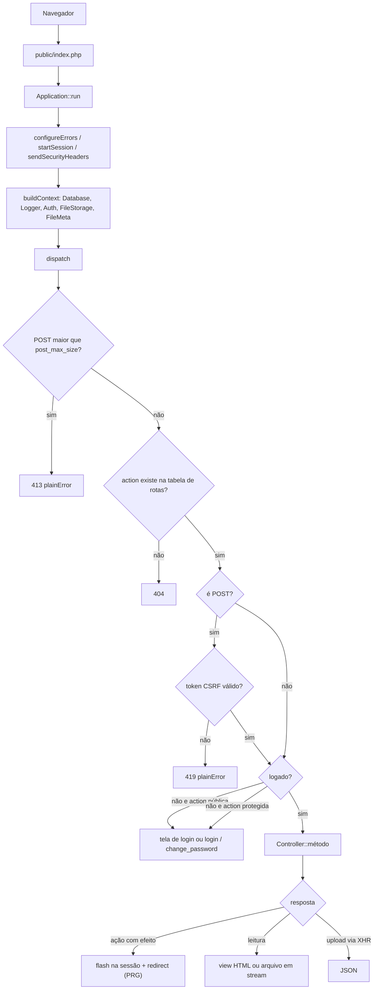
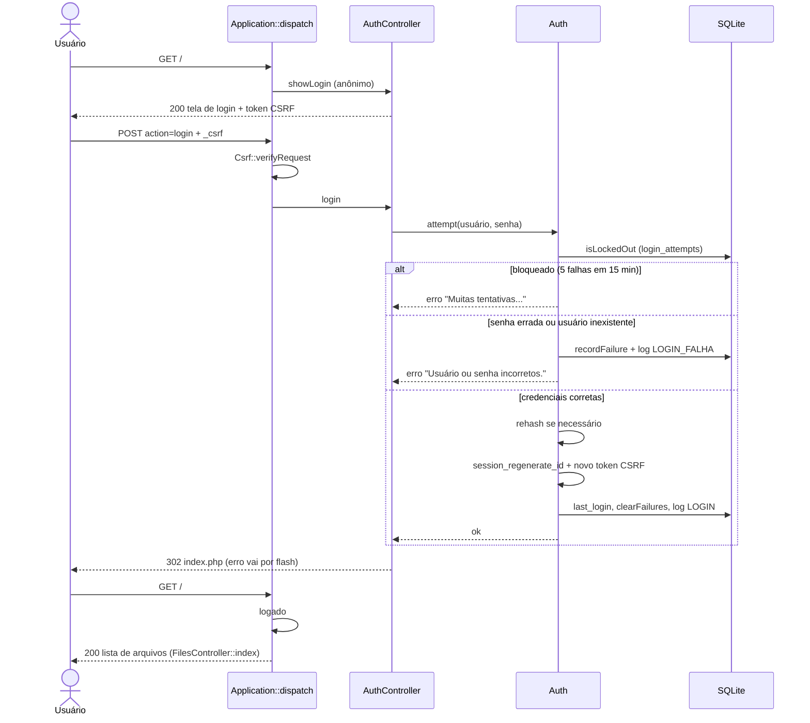
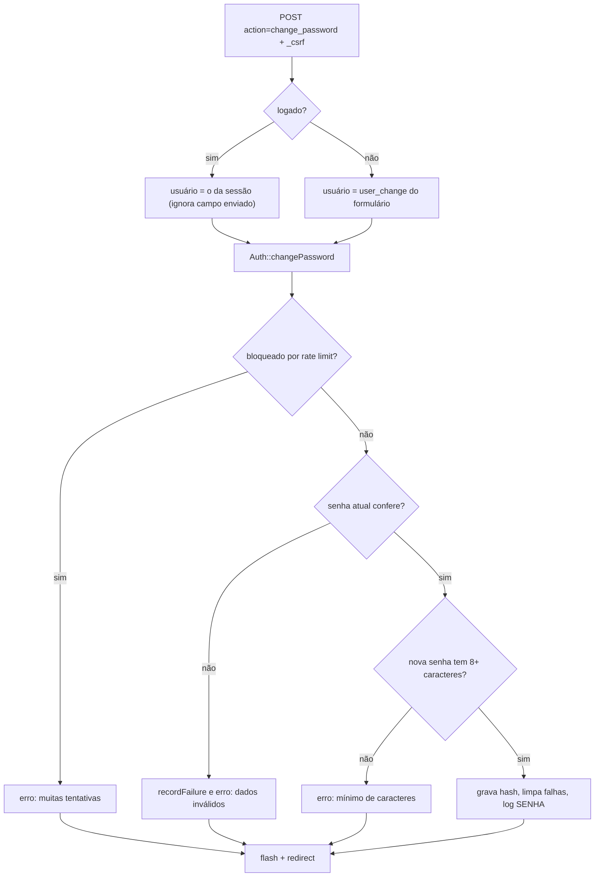
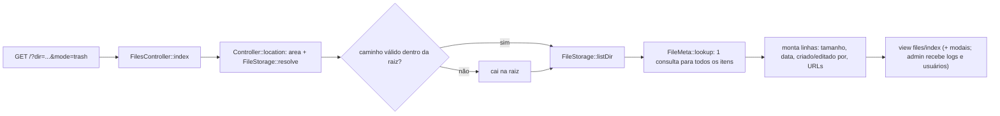
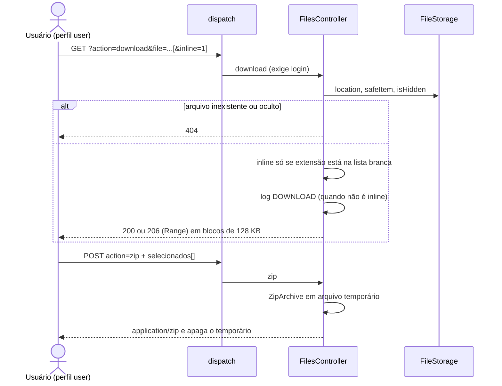
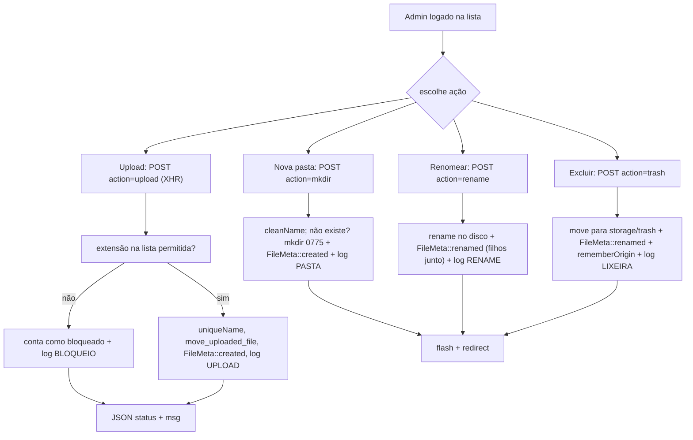
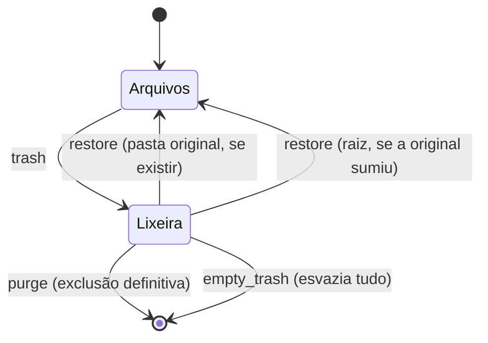
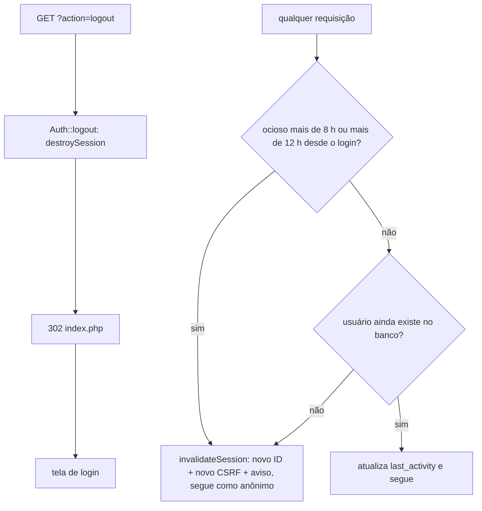

# Fluxos do sistema — do login à ação final

Como ler: cada fluxo tem um diagrama (Mermaid) e uma tabela *passo → código*. Os trechos `arquivo:Lx-Ly` vêm do mapa do **Trail-Code** (`trail skeleton` / `trail callers`, versão 0.25.0). Os comportamentos (status HTTP, redirects, mensagens) foram **reexecutados contra o servidor de teste** (PHP 8.3, cópia isolada dos dados, usuários de teste).

Grafo interativo do código: [`fluxos/viz/index.html`](fluxos/viz/index.html) (arquivo único; abrir no navegador).

> **Limite do grafo.** O Trail só enxerga chamadas estáticas. Duas ligações não viram aresta e estão descritas aqui à mão: (1) o despacho `Application::dispatch` → controller (`(new $class($ctx))->$method()`, a partir de `GET_ROUTES`/`POST_ROUTES`); (2) chamadas por propriedade, como `$this->ctx->auth->attempt()`. Os dois pontos estão marcados com ⚙️ nas tabelas.

## Índice

1. [Visão geral de uma requisição](#1-visão-geral-de-uma-requisição)
2. [Login](#2-login)
3. [Trocar senha](#3-trocar-senha)
4. [Navegar e listar](#4-navegar-e-listar)
5. [Ação final do usuário comum](#5-ação-final-do-usuário-comum-baixar-ver-zip)
6. [Ações finais do admin](#6-ações-finais-do-admin-upload-pasta-renomear-lixeira)
7. [Ciclo da lixeira](#7-ciclo-da-lixeira)
8. [Usuários](#8-gestão-de-usuários)
9. [Logout e expiração](#9-logout-e-expiração-de-sessão)
10. [Matriz perfil × ação final](#10-matriz-perfil--ação-final)
11. [Onde cada negação nasce](#11-onde-cada-erro-ou-negação-nasce)

---

## 1. Visão geral de uma requisição

| Passo | Código |
|---|---|
| Ponto de entrada | `public/index.php` → `Application::run` (`src/Application.php:L54-L67`) |
| Erros, sessão, headers | `configureErrors` L153-L163 · `startSession` L127-L145 (cookie `INTRANETSESSID`, HttpOnly, SameSite=Lax, Secure em HTTPS ou com `INTRANET_FORCE_HTTPS=1`; `gc_maxlifetime` = 8 h) · `isHttps` L148-L151 · `sendSecurityHeaders` L153-L162 (inclui HSTS em HTTPS) |
| Serviços | `buildContext` L107-L125 (conecta SQLite, cria tabelas, sorteia limpeza de logs 1/50) |
| Roteamento | `dispatch` L69-L105 · tabelas `GET_ROUTES` L22 / `POST_ROUTES` L28 / `PUBLIC_ACTIONS` L44 |
| CSRF ⚙️ | `Csrf::verifyRequest` (`src/Csrf.php:L29-L34`), chamado em `dispatch` |
| Erros curtos | `plainError` L176-L188 (JSON se a requisição for XHR) |
| Pós-ação | `Controller::flash` / `redirect` / `redirectBack` (`src/Controllers/Controller.php:L47-L71`); mensagem é lida na página seguinte por `takeFlash` L53-L58 |

Rotas (resumo): GET `''`, `download`, `logout`. POST `login`, `change_password` (públicas); `mkdir`, `rename`, `upload`, `trash`, `zip`, `restore`, `purge`, `empty_trash`, `create_user`, `delete_user`.

---

## 2. Login

| Passo | Código |
|---|---|
| Tela de login | `AuthController::showLogin` (`src/Controllers/AuthController.php:L8-L15`) → `takeFlash`, `view('login')` (`?form=change` abre direto o formulário de nova senha) |
| Envio ⚙️ | `AuthController::login` L17-L24 → `Auth::attempt` (`src/Auth.php:L119-L156`) |
| Rate limit | `isLockedOut` L351-L359 · `recordFailure` L361-L367 · `clearFailures` L369-L373 · `logBlockedOnce` L313-L324 (1 registro `LOGIN_BLOQUEADO` por IP e janela) |
| Senha | `verifyPassword` L300-L304: **sempre** roda `password_verify`, contra `DUMMY_HASH` se o login não existe (sem diferença de tempo); `hash` L291-L294 (bcrypt, custo fixo 10); rehash → `setPasswordHash` L276-L280. Log da falha usa `logLabel` L307-L310: login real, ou `desconhecido#<hash>` (nunca o texto digitado) |
| Sessão segura | `session_regenerate_id(true)` + `Csrf::regenerate` (`src/Csrf.php:L17-L20`) |
| Estado logado | `Auth::user` L48-L84: lê `user_id` da sessão, **recarrega usuário/role do banco**, aplica expiração por inatividade (8 h) e teto absoluto (12 h desde o login, `login_at`); se expirou ou o usuário sumiu, `invalidateSession` L331-L340 |

Resultados verificados: GET `/` anônimo → 200 (login) · POST sem token → **419** · senha errada → 302 `index.php` com mensagem · senha correta → 302 `index.php` → 200 lista · 5 falhas → bloqueio mesmo com a senha certa.

---

## 3. Trocar senha

Dois pontos de entrada, mesmo código: formulário **público** na tela de login e botão 🔑 do painel (qualquer perfil).

Código: `AuthController::changePassword` (`src/Controllers/AuthController.php:L36-L50`) → `Auth::changePassword` (`src/Auth.php:L169-L191`) → `validatePassword` L282-L289. Logado volta para a pasta atual (`redirectBack`); deslogado volta ao login (em caso de erro, para `index.php?form=change`, já com o formulário de nova senha aberto).

---

## 4. Navegar e listar

| Passo | Código |
|---|---|
| Área (`mode=trash` só vale para admin) | `Controller::area` (`src/Controllers/Controller.php:L21-L25`) |
| Pasta atual | `location` L28-L34 → `FileStorage::resolve` (`src/Services/FileStorage.php:L42-L70`): rejeita `..`, confere realpath com `/` final |
| Listagem | `listDir` L117-L134 (oculta `.htaccess`, `web.config`, `.lixeira`, `database.db`) |
| Autoria | `FileMeta::lookup` (`src/Services/FileMeta.php:L60-L78`) |
| Tela | `FilesController::index` (`src/Controllers/FilesController.php:L14-L80`) → `src/Views/files/index.php` |

---

## 5. Ação final do usuário comum: baixar, ver, ZIP

| Passo | Código |
|---|---|
| Download / visualizar | `FilesController::download` (`src/Controllers/FilesController.php:L214-L239`) |
| Entrega | `stream` L277-L340: `Content-Type` por lista branca (jpg, png, gif, webp, pdf, mp4, txt), SVG/XML sempre `attachment`, `nosniff`, suporte a `Range` (206/416), libera a sessão antes de transmitir |
| ZIP | `FilesController::zip` L241-L271 (só área de arquivos; itens ocultos ignorados; log `ZIP`) |
| Sem login ⚙️ | `dispatch` troca a ação protegida pela tela de login (nunca entrega arquivo) |

Verificado: txt inline → `text/plain` `inline`; SVG com `inline=1` → `application/octet-stream` `attachment`; PDF com `Range: bytes=0-99` → 206 e `Content-Length: 100`; `?file=../database.db` → 404; download anônimo → tela de login.

**Ação final do perfil `user`:** receber o arquivo (download, visualização ou ZIP). Qualquer POST de admin é negado (seção 11).

---

## 6. Ações finais do admin: upload, pasta, renomear, lixeira

Todas começam por `requireAdmin` (`Controller.php:L87-L96`) e terminam em **flash + redirect** (o upload via XHR responde JSON e a página recarrega).

| Ação | Código | Efeitos |
|---|---|---|
| Upload | `FilesController::upload` `L163-L208` | só área de arquivos; nome limpo/único; erros por arquivo contados; resposta `{"status","msg"}` |
| Nova pasta | `mkdir` `L86-L101` | nome inválido ou já existente → "Nome inválido." |
| Renomear | `rename` `L103-L134` | arquivo mantém a extensão; destino existente → "Erro/Existe." |
| Para a lixeira | `trash` `L137-L161` | grava a **origem** para restaurar depois |

Verificado: upload de `.txt` + `.exe` → `{"status":"warning","msg":"1 enviados, 1 bloqueados."}`; renomear pasta mantém "Criado por" dos filhos.

---

## 7. Ciclo da lixeira

| Ação | Código | Detalhe |
|---|---|---|
| Restaurar | `TrashController::restore` (`src/Controllers/TrashController.php:L10-L53`) | usa `FileMeta::origin`; se a pasta original não existe mais, vai para a raiz; nome conflitante ganha " (1)" |
| Excluir definitivo | `purge` L55-L73 | apaga disco, metadados e origem; log `LIXEIRA` |
| Esvaziar | `emptyTrash` L75-L93 | percorre `storage/trash`, limpa metadados e origens |

Depois de cada ação o admin continua na visão da lixeira (`index.php?mode=trash`).

---

## 8. Gestão de usuários

| Ação | Código | Regras |
|---|---|---|
| Criar | `UsersController::create` (`src/Controllers/UsersController.php:L7-L18`) → `Auth::createUser` (`src/Auth.php:L176-L195`) | login 3-50 (letras, números, `. _ -`); role só `admin`/`user`; senha ≥ 8; login duplicado → "Já existe." |
| Excluir | `UsersController::delete` L20-L31 → `Auth::deleteUser` L212-L235 | não exclui a si mesmo; não exclui o **último admin** |
| Fora do site | `bin/create-user.php` → `Auth::createUser` L198-L217 / `resetPassword` L220-L231 | único jeito de criar o primeiro admin |

Efeito imediato: como `Auth::user` relê o banco a cada requisição, um usuário apagado perde a sessão na próxima chamada (verificado).

---

## 9. Logout e expiração de sessão

Código: `AuthController::logout` (`AuthController.php:L25-L29`) → `Auth::logout` L158-L161 → `destroySession` L342-L349; expiração em `Auth::user` L48-L84 → `invalidateSession` L331-L340. Após o logout, o cookie antigo cai na tela de login (verificado). Na expiração a sessão **não é destruída**: troca o ID e o token CSRF e deixa o aviso "Sua sessão expirou. Entre novamente." (por isso o primeiro login depois de expirar não dá mais 419).

---

## 10. Matriz perfil × ação final

| Fluxo (ação final) | Anônimo | `user` | `admin` |
|---|:-:|:-:|:-:|
| Ver tela de login | ✅ | — | — |
| Entrar (`login`) | ✅ | ✅ | ✅ |
| Trocar a própria senha | ✅ (com senha atual) | ✅ | ✅ |
| Listar / buscar | ❌ → login | ✅ | ✅ |
| Baixar / ver / ZIP | ❌ → login | ✅ | ✅ |
| Upload, nova pasta, renomear | ❌ | ❌ negado | ✅ |
| Mover para lixeira | ❌ | ❌ negado | ✅ |
| Ver lixeira, restaurar, excluir, esvaziar | ❌ | ❌ `mode=trash` ignorado | ✅ |
| Criar / excluir usuários, ver logs | ❌ | ❌ negado | ✅ |
| Logout | — | ✅ | ✅ |

---

## 11. Onde cada erro ou negação nasce

| Situação | Resposta | Origem |
|---|---|---|
| Upload maior que `post_max_size` | 413 | `Application::dispatch` (+ `plainError`) |
| Ação inexistente | 404 "Rota não encontrada." | `dispatch` |
| POST sem token ou token inválido | 419 | `dispatch` → `Csrf::verifyRequest` |
| Ação protegida sem login | 200 com tela de login | `dispatch` (troca a ação) |
| Ação de admin por `user` | 302 `index.php` + flash "Acesso negado." (XHR: JSON 403) | `Controller::requireAdmin` L87-L96 |
| `?mode=trash` por `user` | lista normal (ignorado) | `Controller::area` L21-L25 |
| Arquivo inexistente, oculto ou `../` | 404 | `FilesController::download` |
| Range inválido | 416 | `stream` |
| Muitas tentativas de login | mensagem no login | `Auth::isLockedOut` |
| Exceção PHP | 500 genérico + `storage/logs/php-error.log` | `Application::handleFatal` L165-L174 |
