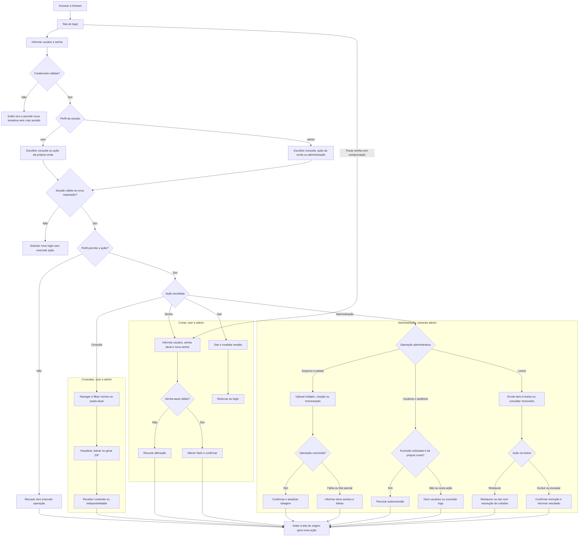
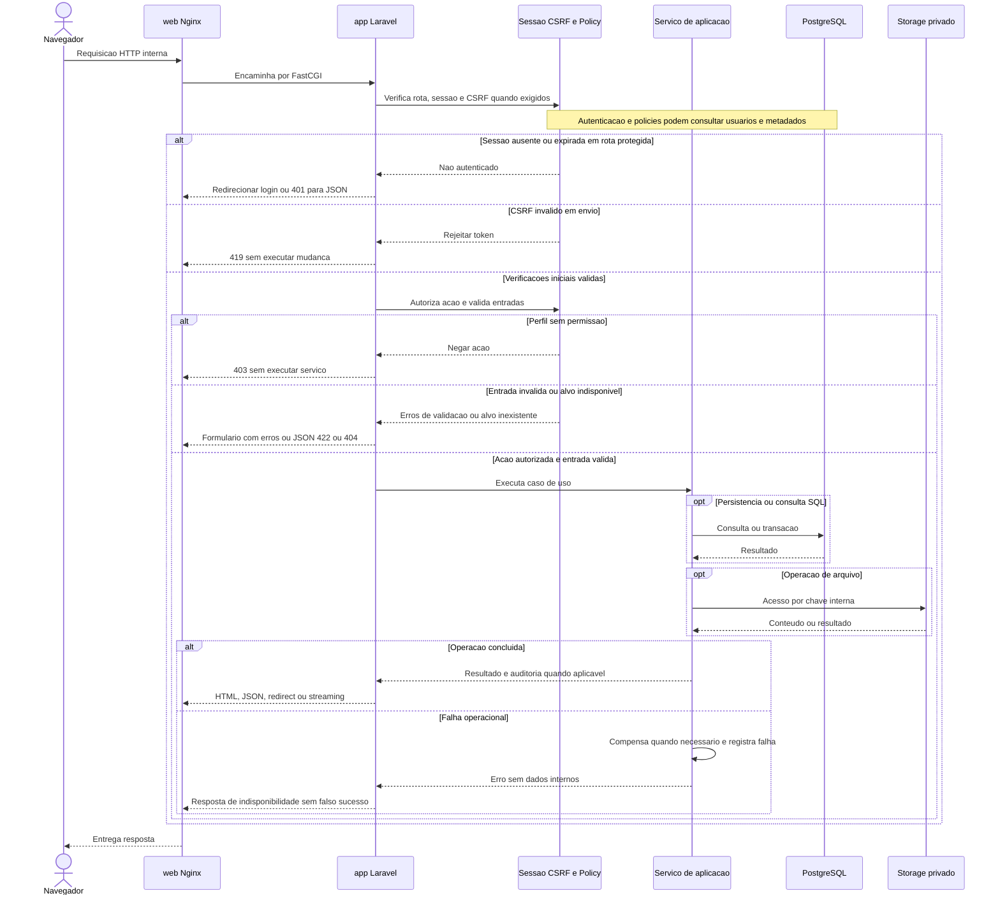
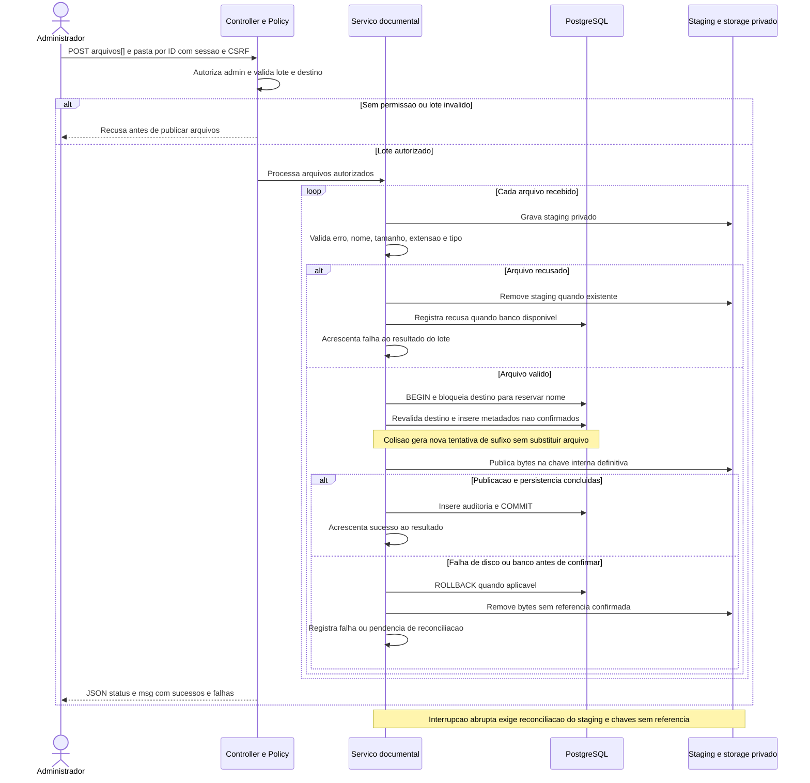
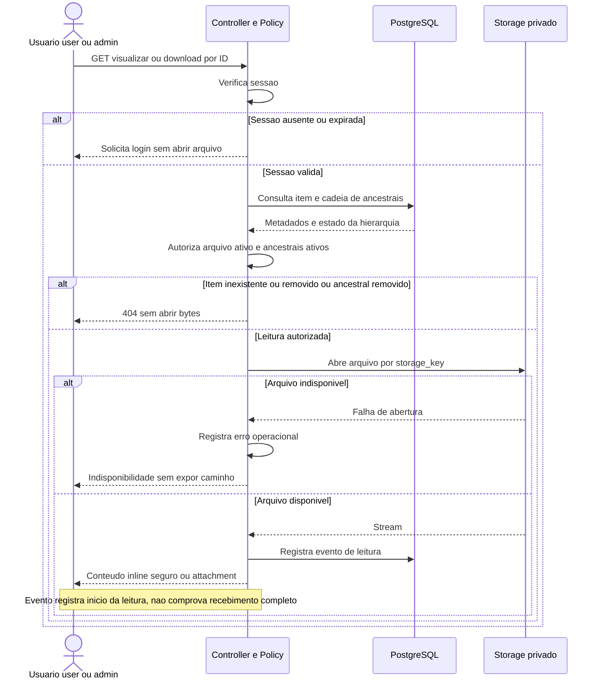
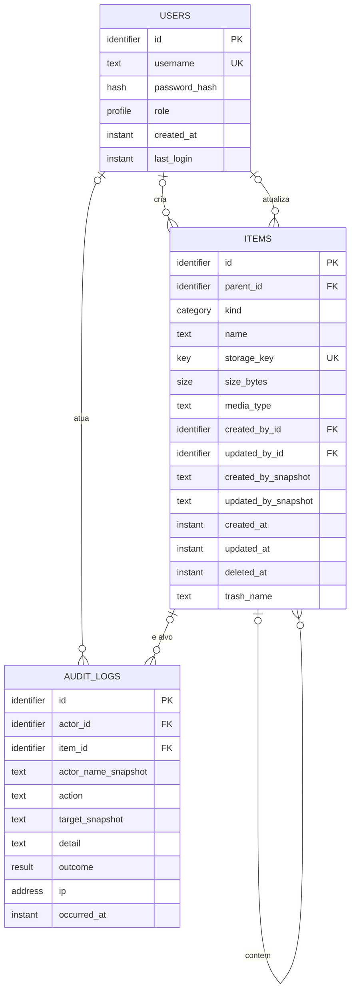
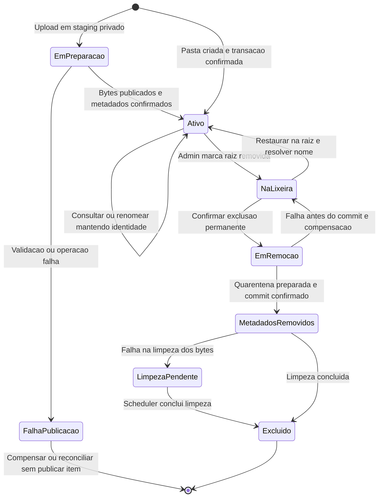
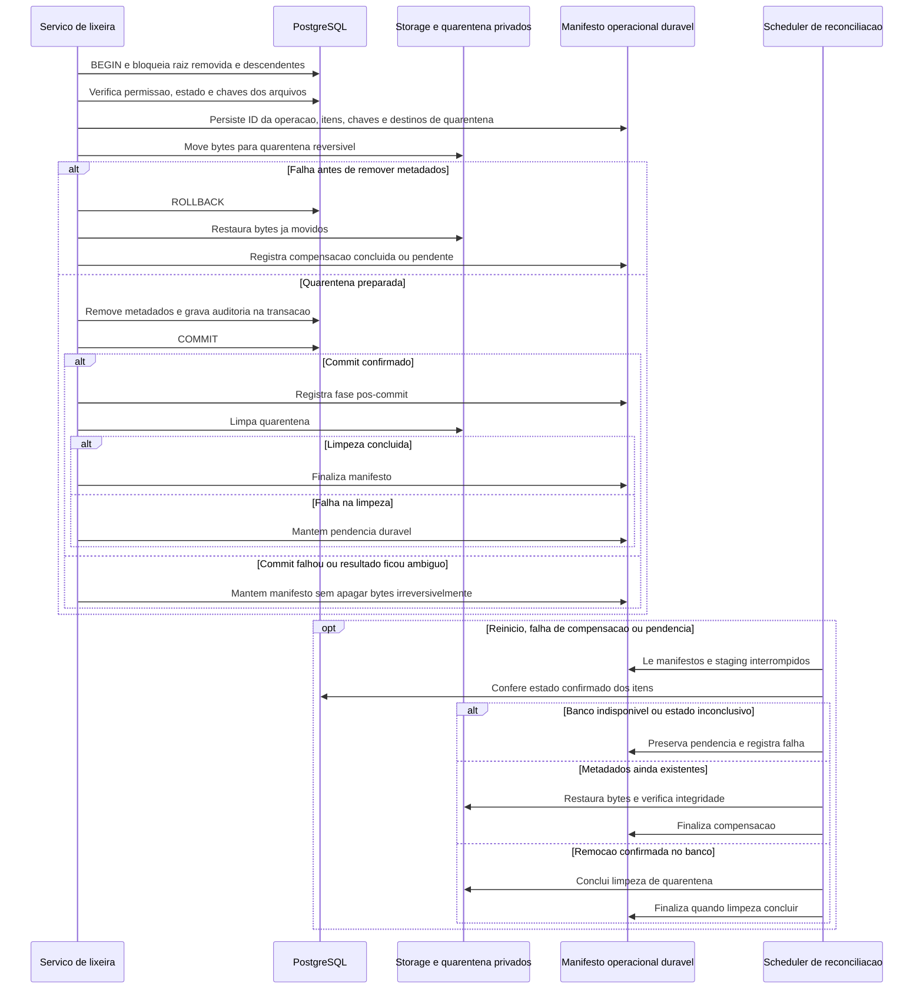
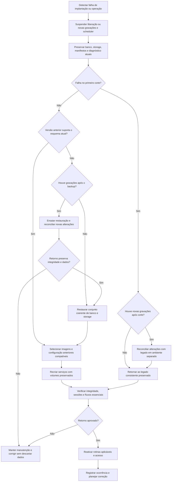

# Modelagem dos fluxos da Intranet FCECON

**Data:** 14 de outubro de 2026  
**Status:** modelagem da solução completa; fundação, Docker local e esquema PostgreSQL implementados. Acesso e consulta implementados na [Sprint 2](sprint-2.md); administração, ciclo documental e produção seguem as próximas sprints.  
**Base:** [arquitetura, regras, requisitos e critérios de aceitação](arquitetura.md).

## 1. Objetivo e leitura dos modelos

Este documento modela quatro perspectivas da Intranet: usuário, API interna, banco e desenvolvimento. A solução usa Laravel, PostgreSQL, armazenamento privado e Docker, preservando os perfis `user` e `admin`.

O [backlog e planejamento de sprints](planejamento.md) transforma estes fluxos em tarefas de implementação, com dependências, evidências e marcos de avaliação pela TI.

Os nove diagramas são identificados por M-01 a M-09. Referências RN, RF, RNF e CA apontam para as definições da arquitetura. As setas descrevem decisões e responsabilidades, não comprovam comportamento já implementado. A API é o conjunto de rotas HTTP internas consumidas pela interface Blade/JavaScript, com sessão e CSRF; não haverá API REST externa nesta versão.

| Perspectiva | Diagramas | Pergunta respondida |
|---|---|---|
| Usuário | M-01 | O que cada perfil pode fazer e como recebe o resultado? |
| API interna | M-02, M-03, M-04 | Como a requisição é autorizada, executada e respondida? |
| Banco | M-05, M-06, M-07 | Como entidades, estados e operações mantêm a integridade? |
| Desenvolvimento | M-08, M-09 | Como o código vira uma entrega e como retornar após falha? |

## 2. Fluxo de usuário

### M-01 — Jornadas e decisões por perfil

O painel de consulta é comum aos dois perfis. O filtro procura nomes somente na pasta atual; ZIP reúne arquivos selecionados dessa pasta, sem incluir pastas recursivamente. A troca de senha exige a senha atual, inclusive antes do login, e não oferece recuperação por e-mail.

Os nós de sessão e permissão precedem a execução de cada nova ação protegida. Esconder botões não impede requisições administrativas diretas: elas também precisam ser recusadas. Uma sessão expirada exige novo login; uma ação sem permissão é recusada sem executar mudanças. Os nós de retorno encerram a ação modelada; a próxima ação repete as verificações, sem pressupor sessão ainda válida.

| Ação | Visitante | `user` | `admin` | Referências |
|---|---|---|---|---|
| Login e troca de senha com comprovação | Sim | Sim | Sim | RN-01, RN-06; RF-01, RF-02; CA-01, CA-02 |
| Navegar, filtrar, visualizar, baixar e gerar ZIP | Não | Sim | Sim | RN-02, RN-14, RN-15; RF-04, RF-05, RF-06; CA-04, CA-05, CA-06 |
| Upload, pasta e renomeação | Não | Não | Sim | RN-03, RN-07, RN-08, RN-09, RN-10; RF-07, RF-08; CA-07, CA-08 |
| Enviar à lixeira, restaurar e excluir permanentemente | Não | Não | Sim | RN-11, RN-12, RN-13; RF-09, RF-10; CA-09, CA-10 |
| Criar/listar/excluir usuários e consultar auditoria | Não | Não | Sim | RN-04, RN-05, RN-17; RF-03, RF-12; CA-03, CA-12 |
| Alterar tema e usar layout adaptável | Tela de login | Sim | Sim | RF-13; CA-15 |

A restauração sempre vai para a raiz, com sufixo em caso de colisão. Pastas restauradas mantêm seus descendentes. Durante a exclusão, todo descendente de uma pasta removida fica inacessível pela área ativa.

## 3. Fluxo da API interna

### M-02 — Processamento geral da requisição

Rotas públicas de login e troca de senha dispensam sessão autenticada, mas exigem validação de credenciais e CSRF no envio. Recusas podem precisar consultar usuários ou metadados; elas impedem execução do serviço de alteração e abertura dos bytes privados, não necessariamente toda consulta ao banco.

Formulários recebem redirecionamento com mensagens/erros; clientes JSON recebem códigos e corpo próprios. O upload envia `Accept: application/json`, mantendo `status` e `msg`. Erros de infraestrutura não são classificados como sucesso. GET pode registrar auditoria de leitura, mas não altera documentos, contas ou lixeira.

### M-03 — Upload com sucesso parcial e compensação

O controller chama o serviço após a autorização. O staging e a publicação são privados; nenhum item é listado antes de metadados e auditoria serem confirmados. A transação é por arquivo, permitindo aceitar parte do lote. A confirmação precisa tratar falha do commit e resultado ambíguo de conexão: antes de apagar bytes, conferir se existe referência confirmada no banco. Se o banco estiver indisponível, preservar a pendência para reconciliação, sem remover o arquivo às cegas.

No caso de colisão SQL, reiniciar a transação/tentativa necessária em vez de continuar uma transação abortada. Revalidar o destino após obter a trava: uma pasta removida durante o envio não pode receber publicação.

O progresso no navegador mede transmissão dos bytes; o resultado final vem da resposta do serviço. Falha total por indisponibilidade usa resposta de erro; `warning` é usado para resultado parcial processado, sem esconder uma falha global.

**Referências:** RN-03, RN-07, RN-08, RN-16, RN-17; RF-07, RF-11; RNF-01, RNF-04, RNF-08, RNF-09; CA-07, CA-11, CA-12, CA-13.

### M-04 — Visualização e download autorizados

Miniaturas e visualizações também passam por rotas autenticadas. O Nginx não serve o acervo diretamente. Conteúdo sem visualização segura é entregue como download; PDF, imagens raster, MP4 e TXT seguem o comportamento funcional previsto.

ZIP usa POST com CSRF, autoriza cada arquivo selecionado da pasta atual e cria um temporário exclusivo. Não inclui pastas recursivamente. O temporário é removido após a resposta ou pela reconciliação se houver interrupção.

**Referências:** RN-01, RN-02, RN-14, RN-17; RF-05, RF-06; RNF-01, RNF-02, RNF-08; CA-01, CA-05, CA-06, CA-12, CA-13.

### 3.1 Operações HTTP e respostas

| Método | Rota | Acesso e entrada principal | Resposta esperada |
|---|---|---|---|
| GET / POST | `/login` | Pública; usuário e senha no POST, com CSRF. | Tela HTML; redirecionamento após login ou erro de credenciais. |
| GET / POST | `/senha` | Pública com comprovação; usuário, senha atual e nova senha. | HTML/redirecionamento com confirmação ou erros. |
| POST | `/logout` | Sessão autenticada e CSRF. | Invalidação da sessão e redirecionamento para login. |
| GET | `/documentos` | `user` e `admin`; pasta por ID ou raiz. | Listagem HTML com breadcrumbs e filtro local. |
| POST | `/documentos/upload` | `admin`; multipart `arquivos[]`, pasta por ID e CSRF. | JSON com `status` e `msg`; erro HTTP em recusa/falha global. |
| POST | `/pastas` | `admin`; nome, pasta pai e CSRF. | Redirecionamento com confirmação ou erros. |
| PATCH | `/itens/{id}` | `admin`; novo nome e CSRF. | Confirmação/erro; extensão de arquivo preservada. |
| DELETE | `/itens/{id}` | `admin`; ID e CSRF. | Resultado do envio à lixeira. |
| GET | `/arquivos/{id}/visualizar` | Ambos; arquivo e ancestrais ativos. | Stream inline seguro ou download conforme formato. |
| GET | `/arquivos/{id}/download` | Ambos; arquivo e ancestrais ativos. | Stream com nome de apresentação e attachment. |
| POST | `/documentos/zip` | Ambos; IDs de arquivos da mesma pasta e CSRF. | Stream ZIP ou mensagem de falha. |
| GET | `/lixeira` | Somente `admin`. | Listagem HTML de raízes removidas. |
| POST | `/lixeira/{id}/restaurar` | `admin`; ID e CSRF. | Resultado da restauração na raiz com resolução de colisões. |
| DELETE | `/lixeira/{id}` | `admin`; ID, confirmação e CSRF. | Resultado da remoção permanente. |
| DELETE | `/lixeira` | `admin`; confirmação e CSRF. | Resultado de esvaziamento, incluindo falhas parciais. |
| GET / POST | `/usuarios` | `admin`; no POST, login, senha e perfil válido. | Lista HTML ou resultado do cadastro. |
| DELETE | `/usuarios/{id}` | `admin`; ID e CSRF; autoexclusão bloqueada. | Resultado da exclusão sem remover acervo/histórico. |
| GET | `/auditoria` | Somente `admin`. | HTML com os 50 eventos mais recentes. |

HTML usará method spoofing para PATCH/DELETE. IDs não autorizam acesso por si só; caminhos físicos não serão aceitos como contrato de entrada. Cabeçalhos e mensagens não expõem SQL, credenciais ou caminhos privados.

## 4. Fluxo do banco

### M-05 — Entidades e relacionamentos lógicos

Os tipos no diagrama são conceituais, não definições de colunas PostgreSQL. A identidade do item é estável; renomear não muda o ID ou a chave dos bytes. `parent_id` nulo representa raiz e pastas não têm arquivo físico próprio. A leitura verifica o estado do item e toda a cadeia de ancestrais.

Referências de autoria e ator são opcionais para dados históricos desconhecidos ou usuários excluídos. Snapshots preservam os nomes e alvos conhecidos; ausência de autoria não será atribuída ao importador. Excluir usuário não apaga documentos nem auditoria. Exclusão permanente de item preserva eventos com alvo textual e referência nula quando necessário.

O banco guarda estrutura, metadados, usuários e auditoria; os volumes privados guardam documentos, staging, quarentena, sessões e manifestos operacionais. Logs de diagnóstico do processo ficam separados da auditoria. Não serão criadas tabelas físicas, SQL ou migrations nesta etapa.

**Referências:** RN-05, RN-16, RN-17; RF-03, RF-11, RF-12; RNF-04, RNF-09; CA-03, CA-08, CA-11, CA-12, CA-14.

### M-06 — Ciclo de vida do item documental

`EmPreparacao`, `EmRemocao` e `LimpezaPendente` são estados operacionais do fluxo, não uma nova coluna de estado proposta. No banco, a visibilidade decorre da existência de metadados confirmados e de `deleted_at` no item/ancestrais. Manifestos privados representam pendências operacionais de remoção.

Quando uma pasta entra na lixeira, seus filhos mantêm `parent_id`; eles ficam efetivamente removidos por herança do estado do ancestral, mesmo sem `deleted_at` próprio. A listagem ativa e as rotas de leitura devem excluí-los. A restauração da pasta preserva sua hierarquia e a coloca na raiz, sem reconstruir a pasta de origem.

Após o commit da remoção permanente, os metadados podem não existir mais enquanto a limpeza física está pendente. Essa pendência fica registrada no manifesto e não torna o arquivo consultável. Informar limpeza pendente em vez de anunciar remoção física integral; o scheduler verifica o estado antes de concluir.

**Referências:** RN-08, RN-10, RN-11, RN-12, RN-13; RF-08, RF-09, RF-10; RNF-02, RNF-04; CA-05, CA-08, CA-09, CA-10, CA-13.

### M-07 — Consistência, compensação e reconciliação

SQL e filesystem não compartilham transação. O manifesto precisa ser durável antes de mover bytes, e sua recuperação deve suportar interrupção entre qualquer duas etapas. A rotina verifica o estado real no banco, não confia somente na última fase escrita no manifesto. Repetir a operação não pode apagar um arquivo ativo, duplicar auditoria ou falhar por um arquivo já limpo.

Renomeação, criação de pasta e lixeira lógica são transações de metadados/auditoria sem movimentação de bytes. Upload usa o fluxo M-03. No esvaziamento da lixeira, cada raiz removida tem operação própria e resultado independente.

**Referências:** RN-11, RN-12, RN-17; RF-09, RF-10, RF-12; RNF-04, RNF-06, RNF-09; CA-10, CA-12, CA-13, CA-14, CA-19.

### 4.1 Leituras, gravações e efeitos no disco

| Operação | Leitura PostgreSQL | Gravação PostgreSQL | Disco/volume privado |
|---|---|---|---|
| Login | Usuário por login e hash/perfil. | Último acesso e evento de login após credenciais válidas. | Cria/regenera sessão; não lê documentos. |
| Troca de senha | Usuário e hash atual. | Novo hash e evento sem senha aberta. | Sem alteração do acervo. |
| Navegação/listagem | Itens da pasta e estado dos ancestrais. | Sem alteração documental. | Metadados de tamanho/tipo usados na listagem; sem servir bytes diretamente. |
| Visualização/download | Item, chave e ancestrais ativos. | Evento de início de leitura. | Abre bytes por chave e transmite stream. |
| ZIP | Itens selecionados e hierarquia autorizada. | Evento da operação. | Lê arquivos, gera ZIP exclusivo e limpa temporário. |
| Upload | Destino, ancestrais e nomes existentes. | Item, autoria e auditoria na confirmação por arquivo. | Staging, publicação e compensação/reconciliação quando necessário. |
| Criar pasta | Pasta pai e disponibilidade do nome. | Item do tipo pasta e evento. | Sem criação de diretório do acervo físico. |
| Renomear | Item, parent e colisões de nome. | Nome, atualização/autoria e evento, mantendo ID/chave. | Bytes não se movem. |
| Enviar à lixeira | Raiz ativa e destino lógico de lixeira. | `deleted_at`, nome de lixeira e evento na raiz. | Bytes não se movem; descendentes ficam inacessíveis. |
| Restaurar | Raiz removida e colisões na raiz ativa. | Parent raiz, nome resolvido, estado ativo e evento. | Mesmos bytes e chaves. |
| Excluir permanentemente | Raiz removida, descendentes e chaves. | Remove metadados e registra evento com snapshot. | Manifesto, quarentena, compensação ou limpeza posterior. |
| Criar/listar/excluir usuário | Login, perfil e verificação de autoexclusão. | Cadastro/exclusão; referências opcionais e eventos preservados. | Sem remover documentos. |
| Auditoria | Últimos 50 eventos por ID decrescente. | Registro pelo serviço de aplicação, não por ações de edição na interface. | Logs operacionais separados do acervo. |

Dados históricos desconhecidos permanecem ausentes. Horários e referências do legado serão tratados no ensaio de migração, sem inferir autoria ou precisão temporal que o banco de origem não fornece.

## 5. Fluxo de desenvolvimento

### 5.1 Serviços, imagens, configuração e volumes

| Serviço | Artefato e função | Persistência |
|---|---|---|
| `web` | Imagem Nginx com assets públicos do mesmo commit da aplicação. | Certificados/configuração de entrada; não monta storage privado. |
| `app` | Imagem Laravel/PHP 8.4 FPM. | Volume de storage privado; conexão interna com `db`. |
| `db` | Imagem PostgreSQL oficial com versão fixada na entrega. | Volume estável de banco, separado do storage. |
| `scheduler` | Mesma imagem/tag de `app`; comando de agendamento em vez de FPM. | Compartilha banco, storage e configuração; uma instância. |

O computador Windows usará Docker Desktop com WSL2 e containers Linux. A VM usará Docker Engine e Compose, previamente instalados. Código pode ser montado em desenvolvimento; produção executa o código das imagens, sem montagem do repositório.

As imagens levam código, dependências de execução e assets. Configuração, credenciais e certificados são fornecidos separadamente. Banco, documentos, sessões, staging, quarentena e manifestos ficam em volumes persistentes. Cache de configuração Laravel é regenerado para o ambiente, não copiado do computador local.

Não executar remoção de volumes como etapa de atualização. Manter a `APP_KEY` estável para preservar o uso do estado criptografado entre recriações. Dados de teste não se conectam aos volumes de produção.

### M-08 — Desenvolvimento até implantação por arquivo

```mermaid
flowchart TD
    CODIGO["Alterar código e registrar revisão"] --> LOCAL["Iniciar Compose de desenvolvimento"]
    LOCAL --> TESTES["Executar testes com banco e storage isolados"]
    TESTES --> OK{"Testes aprovados?"}
    OK -->|"Não"| CODIGO
    OK -->|"Sim"| REVISAO["Revisar e identificar commit da entrega"]
    REVISAO --> BUILD["Build de imagens app e web com dependências e assets"]
    BUILD --> FINAIS["Testar imagens finais sem montagem do código"]
    FINAIS --> PASSOU{"Entrega validada?"}
    PASSOU -->|"Não"| CODIGO
    PASSOU -->|"Sim"| PACOTE["docker image save: app, web e PostgreSQL"]
    PACOTE --> MANIFESTO["Gerar tar, Compose, versão, plataforma, IDs e checksum"]
    MANIFESTO --> TRANSFERIR["Transferir pacote à VM Linux"]
    TRANSFERIR --> VERIFICAR["Verificar checksum, plataforma e configuração"]
    VERIFICAR --> VALIDO{"Pacote íntegro e compatível?"}
    VALIDO -->|"Não"| ABORTA["Abortar sem alterar serviços ou dados"]
    VALIDO -->|"Sim"| LOAD["docker image load e confirmar todas as imagens"]
    LOAD --> CONF["Provisionar configuração, segredos e certificados"]
    CONF --> JANELA["Bloquear gravações e suspender scheduler para o corte"]
    JANELA --> PRIMEIRA{"Primeira implantação?"}
    PRIMEIRA -->|"Sim"| INICIAL["Backup do legado e provisionamento de db e volumes novos"]
    PRIMEIRA -->|"Não"| BACKUP["Backup coordenado de banco, storage e manifestos"]
    INICIAL --> MIGRA["Executar migrations explicitamente na imagem app"]
    BACKUP --> MIGRA
    MIGRA --> IMPORTA["Na primeira implantação: importar e conferir o legado"]
    IMPORTA --> SUBIR["Iniciar web, app e scheduler sem build ou pull"]
    SUBIR --> SAUDE["Verificar healthchecks, integridade e fluxos essenciais"]
    SAUDE --> PRONTO{"Verificação aprovada?"}
    PRONTO -->|"Sim"| LIBERA["Liberar acesso e acompanhar operação"]
    PRONTO -->|"Não"| RETORNO["Acionar M-09 mantendo gravações suspensas"]
    MIGRA -->|"Falha"| RETORNO
    IMPORTA -->|"Falha"| RETORNO
```

O build multi-stage pode usar Composer/Node e rede no computador local. As imagens finais não precisam dessas ferramentas na VM. Aplicação e web devem representar o mesmo commit; a imagem de PostgreSQL necessária também vai no `.tar`. O scheduler não exige imagem adicional.

O manifesto de entrega registra versão, commit, plataforma, tags fixadas e IDs das imagens carregáveis. O checksum confirma integridade do arquivo transferido. Adotar `linux/amd64` como referência e confirmar CPU da VM antes do build; não supor que toda imagem local roda em qualquer arquitetura.

Após importar, usar Compose de produção sem build e sem pull, com segredos/certificados provisionados. As migrations são comando explícito de um container temporário da imagem app, posterior ao backup, usando credenciais adequadas; não fazem parte do entrypoint de cada serviço. O primeiro deploy precisa do banco disponível e volumes novos antes das migrations, e do inventário/backup do legado antes da importação.

A rotina scheduler fica suspensa durante migração/backup coordenado e só retorna com a versão validada. Healthchecks verificam prontidão do banco e aplicação/storage; a rotina agendada tem verificação de última execução. Na liberação, apenas web publica portas na VM.

O arquivo de imagens não contém dados nem constitui backup. Não existe publicação em registry nesta versão. Fontes: [Compose em produção](https://docs.docker.com/compose/how-tos/production/), [save](https://docs.docker.com/reference/cli/docker/image/save/) e [load](https://docs.docker.com/reference/cli/docker/image/load/).

**Referências:** RNF-05, RNF-06, RNF-07, RNF-10; CA-14, CA-15, CA-16, CA-17, CA-18, CA-19.

### M-09 — Falha, preservação e retorno

Voltar uma tag de imagem não reverte migrations. A decisão de retorno considera compatibilidade de código, esquema, configuração e dados; se não existir retorno seguro, manter manutenção e corrigir a entrega. O legado não depende do scheduler Docker, portanto a reativação de rotinas respeita o ambiente efetivamente recuperado.

Nunca descartar novas gravações para voltar ao backup. Preservar uma cópia do estado atual antes da reconciliação e ensaiar a recuperação em ambiente separado. Banco e acervo são tratados como conjunto coerente, com conferência de manifesto/hashes e autoria. As imagens e a configuração anteriores ficam disponíveis, mas a `APP_KEY` correspondente ao estado existente é mantida.

**Referências:** RNF-04, RNF-06, RNF-10; CA-10, CA-13, CA-14, CA-18, CA-19.

## 6. Rastreabilidade e validação da modelagem

| Modelo | Principais requisitos | Critérios de aceitação |
|---|---|---|
| M-01 | RF-01 a RF-10, RF-12, RF-13; RNF-01, RNF-03 | CA-01 a CA-10, CA-12, CA-15 |
| M-02 | RF-01 a RF-12; RNF-01, RNF-03, RNF-04, RNF-08 | CA-01, CA-02, CA-03, CA-07, CA-12, CA-13 |
| M-03 | RF-07, RF-11; RNF-01, RNF-04, RNF-08, RNF-09 | CA-07, CA-11, CA-12, CA-13 |
| M-04 | RF-05, RF-06; RNF-01, RNF-02, RNF-08 | CA-01, CA-05, CA-06, CA-12, CA-13 |
| M-05 | RF-03, RF-11, RF-12; RNF-04, RNF-09 | CA-03, CA-08, CA-11, CA-12, CA-14 |
| M-06 | RF-08, RF-09, RF-10; RNF-02, RNF-04 | CA-05, CA-08, CA-09, CA-10, CA-13 |
| M-07 | RF-09, RF-10, RF-12; RNF-04, RNF-06, RNF-09 | CA-10, CA-12, CA-13, CA-14, CA-19 |
| M-08 | RNF-05, RNF-06, RNF-07, RNF-10 | CA-14, CA-15, CA-16, CA-17, CA-18, CA-19 |
| M-09 | RNF-04, RNF-06, RNF-10 | CA-10, CA-13, CA-14, CA-18, CA-19 |

Na revisão documental, conferir:

- Nove diagramas completos, com rotas, perfis, entidades e serviços coerentes com a arquitetura.
- Recusas de sessão/permissão antes de executar alterações ou abrir documentos; CSRF nos envios.
- Exclusão de itens removidos e descendentes em todas as consultas e leituras ativas.
- Identidade estável, autoria ausente preservada, colisões sem sobrescrita e restauração para a raiz.
- Resultado parcial explícito, transação por arquivo e reconciliação que verifica o banco antes de apagar bytes.
- Pacote com todas as imagens, configuração separada, volumes preservados e backup independente.
- Compatibilidade de migrations/dados avaliada no retorno, com preservação das gravações recentes.

Os critérios CA-01 a CA-19 especificam a solução completa. As evidências da [Sprint 1](sprint-1.md) e [Sprint 2](sprint-2.md) registram a execução técnica local e a cobertura do incremento; os diagramas sozinhos não comprovam funcionalidades futuras ou migração.
