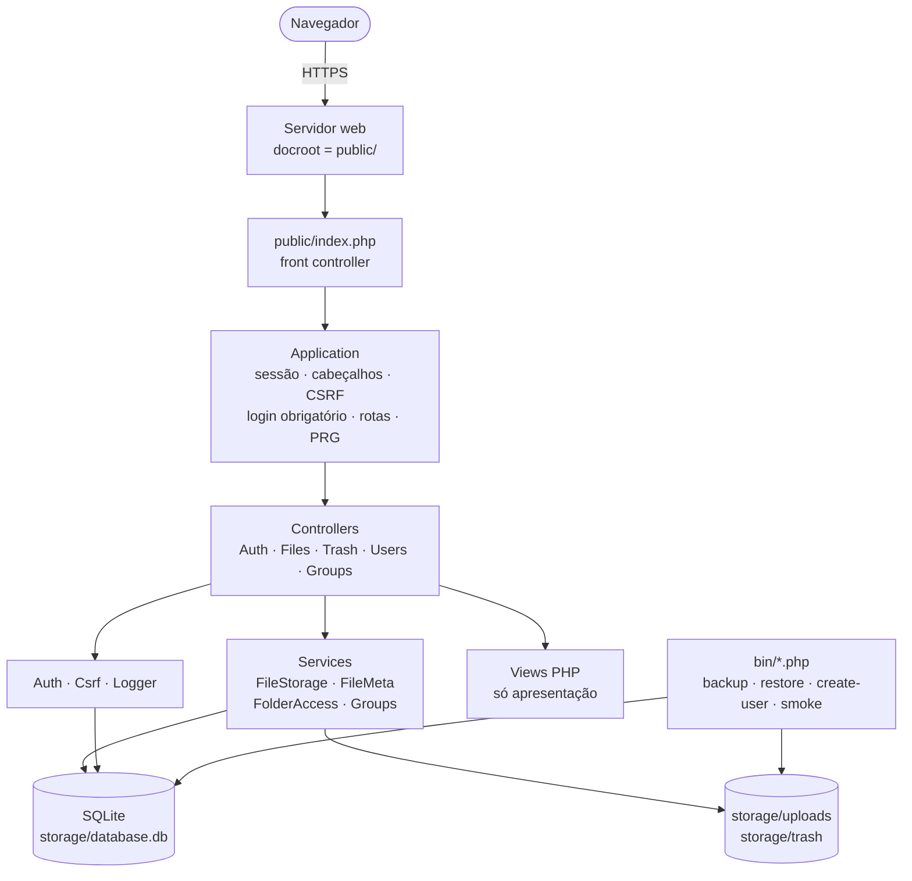
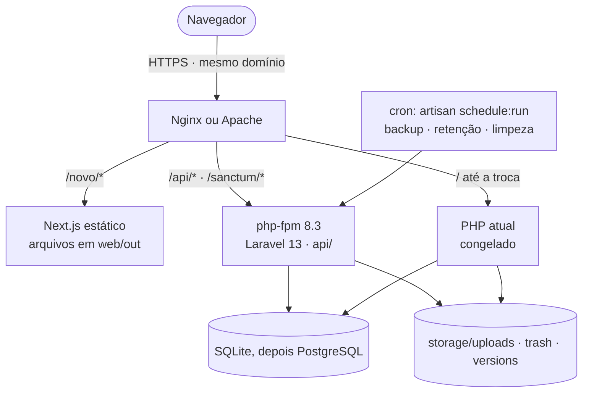
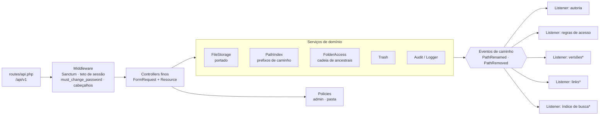
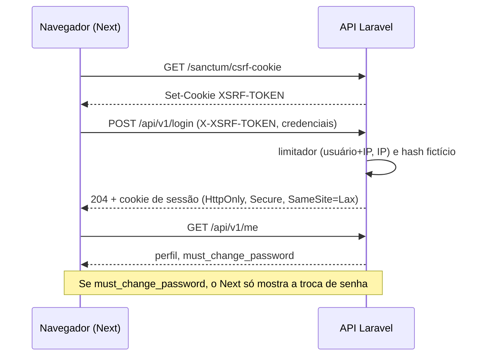
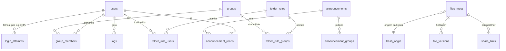

# Revisão de arquitetura — Intranet FCECON

**Data:** 26/10/2026 · **Escopo:** estado atual (PHP puro + SQLite, release 0.2.x) e arquitetura-alvo (Laravel 13 + Next.js 16 estático, [ADR 0008](decisoes/0008-laravel-e-nextjs-em-fatias.md)) · **Método:** leitura do código (`src/`, 2.733 linhas), dos testes e das ADRs; nada foi medido em servidor real.

## 1. Veredito

| Pergunta | Resposta |
|---|---|
| A arquitetura atual serve ao tamanho do sistema? | **Sim.** Camadas finas, uma única porta para o disco (`FileStorage`), CSRF em todo POST, download só por PHP autenticado e 257 testes. O problema não é o desenho, é o **custo de crescer** nele. |
| O alvo (Laravel + Next estático) é coerente? | **Sim, com três ressalvas:** (1) centralizar de vez as operações de caminho; (2) tratar sessão e CSRF entre Next e API como parte do desenho, não como detalhe; (3) manter o disco como fonte da verdade dos arquivos. |
| Qual é o maior risco? | **Chaves de banco baseadas em caminho de texto** (`files_meta`, `folder_rules`…). Os dois defeitos de segurança achados em 26/10 (LIKE que ignora caixa; bytes × caracteres) nasceram aí, e novos módulos (versões, links, busca) vão depender do mesmo mecanismo. |
| O que fazer primeiro? | Um único componente `PathIndex` + eventos de caminho **antes** de portar renomear, mover e lixeira (Sprints 3 e 5 do [kanban](kanban.md)). |

## 2. Requisitos que guiam as escolhas

Os números de carga e disponibilidade são **hipóteses** (não há medição de produção); confirme com a TI.

| Requisito | Meta | Como verificar |
|---|---|---|
| Usuários | de dezenas a poucas centenas; 6 contas hoje, 4 de admin | Cadastro; log de `LOGIN` |
| Escrita concorrente | até 8 escritores simultâneos sem erro | Suíte de concorrência (já existe; portar para Pest) |
| Desempenho de listagem | pasta com 400 itens em menos de 3 s | Teste de desempenho (existe); acrescentar p95 da busca |
| Tamanho de arquivo | até 2 GB por envio | `intranet:smoke` + teste de 500 MB no servidor real |
| Segurança | sem acesso a pasta restrita por nenhum caminho (caixa, `.`, `~1`, acento); CSRF; login endurecido | Matriz de paridade + cenários RH |
| Acessibilidade | WCAG 2.1 AA, contraste ≥ 4,5:1 | axe + teste de contraste + Playwright |
| Disponibilidade | horário comercial; recuperação em horas | Backup restaurável com SHA-256; ensaio na Sprint 8 |
| Operação | equipe pequena; deploy previsível; sem Node em produção | Exportação estática; runbook de [transicao.md](transicao.md) |
| Compatibilidade | PHP 8.3+ na nova stack; Linux com Apache ou Nginx | CI com PHP 8.3, 8.4 e 8.5 |

## 3. Estado atual

### 3.1 Contêineres e componentes



Regra de dependência vigente: Views não tocam banco nem disco; Controllers não montam SQL nem caminhos na mão.

### 3.2 O que está bem

| Ponto | Evidência |
|---|---|
| **Uma porta para o disco** | `FileStorage::resolve/safeItem/cleanName/reserveName` concentram travessia, caixa e nomes atômicos |
| **Defesa em camadas no acesso a pasta** | `Controller::location()` aplica `FolderAccess::allows` (interseção dos ancestrais) em toda ação, inclusive download e ZIP |
| **Falha fechada** | Apagar grupo ou usuário nunca libera pasta; regra vazia = só admins |
| **Operação previsível** | Backup com manifesto SHA-256, restauração em pasta nova, `bin/smoke.php` que reprova docroot errado |
| **Testes como rede de segurança** | 257 verificações, 96,0 % de cobertura, mutação nas regras críticas |

### 3.3 Achados

| # | Achado | Gravidade | Onde | Recomendação |
|---|---|---|---|---|
| A1 | **Chaves de banco são caminhos de texto.** Renomear e mover reescrevem prefixos em 3 a 5 tabelas, e é aí que mora o risco (os dois defeitos de 26/10) | Alta | `FileMeta`, `FolderAccess`, `trash_origin` | Um único `PathIndex` que sabe reescrever prefixos de todas as tabelas, com os testes de caixa e UTF-8; ver D1 |
| A2 | **Efeito de uma operação de caminho espalhado em 17 pontos** de dois controllers (`meta->renamed`, `access->renamed`, `rememberOrigin`, `forgetOrigin`…). Esquecer um ponto deixa autoria ou regra órfã; versões e links multiplicariam isso | Alta | `FilesController` (linhas 168 a 354), `TrashController` (41 a 90) | Eventos de caminho com *listeners*; ver D1 |
| A3 | **`FilesController` com 505 linhas e 16 métodos** mistura listagem, árvore, escrita, upload, download, ZIP, `Range` e regra de acesso | Média | `src/Controllers/FilesController.php` | Dividir por assunto (`BrowseController`, `UploadController`, `DownloadController`); `stream()` vira serviço de resposta |
| A4 | **`Auth` com 388 linhas e muitas responsabilidades**: sessão, login, limite de tentativas, política de senha, CRUD de usuários | Média | `src/Auth.php` | Extrair `LoginThrottle` e `PasswordPolicy` (já previsto na ADR 0005); no Laravel isso vira `RateLimiter` e regras de validação |
| A5 | **Esquema recriado a cada requisição** (`Database::migrate()` com 12 `CREATE ... IF NOT EXISTS`) e **sem versão**; `Backup` e `bin/*` acoplados ao SQLite | Média | `src/Database.php`, `src/Backup.php` | Migrations numeradas (Laravel); backup como comando |
| A6 | **Controle de fluxo por `exit`** em 9 pontos (negar acesso, erro, redirecionar) | Baixa | `Controller::denyAccess`, `Application` | Exceções HTTP tratadas num só lugar; o Laravel já faz isso |
| A7 | **Sessões em arquivo e disco local**: ótimo para um servidor, impede crescer para dois sem trocar o *handler* | Baixa hoje | `Application::startSession` | Sem ação agora; registrar como limite (ADR 0008) |
| A8 | **Busca e árvore percorrem o disco**; funciona no volume atual, sem medição para dezenas de milhares de arquivos | Baixa | `FileStorage::listDir`, `hasSubdirs` | Medir na Sprint 4; limiar para índice FTS5 (D4) |

## 4. Arquitetura-alvo

### 4.1 Contêineres



Um servidor, um domínio, **sem Node em produção** (o Next só roda no CI para gerar arquivos).

### 4.2 Componentes da API



\* módulos da Fase 5 (e a busca, se ganhar índice). Entram como *listeners* sem tocar nos controllers.

### 4.3 Fluxos críticos

**Login pelo Next estático (mesmo domínio, cookie de sessão):**



**Download de arquivo (a regra de acesso nunca é pulada):**

```mermaid
sequenceDiagram
    participant B as Navegador
    participant A as API
    participant D as Disco
    B->>A: GET /api/v1/files/download?dir=…&file=… (com Range)
    A->>A: autenticado? FileStorage::resolve (nome real do disco)
    A->>A: Policy: FolderAccess::allows na cadeia
    A->>D: abre o arquivo (fora do docroot)
    A-->>B: 200/206 + Content-Disposition (lista de MIME; SVG sempre anexo) + nosniff
```

### 4.4 Dados

Tabelas atuais (adotadas pela migration *baseline*) e as que cada módulo acrescenta depois da troca:



`files_meta`, `folder_rules*` e `trash_origin` ligam-se por **caminho de texto**, não por chave estrangeira (ver A1 e D1). As entidades com `*` e as de avisos só nascem depois da troca ([transicao.md](transicao.md), regra 5).

### 4.5 Segurança em camadas

| Camada | Controle | Observação |
|---|---|---|
| Borda | HTTPS, HSTS, `nosniff`, `Referrer-Policy`, CSP (hashes gerados no build do Next) | A CSP é a parte mais delicada da exportação estática (Fase 4) |
| Identidade | Sanctum SPA (cookie), limitador em camadas, hash fictício, troca de senha derruba as outras sessões, senha temporária, TOTP para admins (Fase 5) | A autenticação **só** existe na API; o Next não decide acesso |
| Autorização | Policy de admin e de pasta (interseção de ancestrais); falha fechada | Testada com RH, `RH.`, `RH~1`, acento e caixa |
| Dados em disco | Fora do docroot; leitura só pela API; lista de extensões e de MIME | Links temporários e versões seguem a mesma porta |
| Auditoria | Tabela `logs` com ação, IP, usuário; sem texto digitado no login | Retenção de 180 dias |
| Recuperação | Backup com SHA-256 e restauração em destino novo | Ensaio obrigatório antes da troca |

### 4.6 Implantação

Um único servidor Linux: Nginx ou Apache, php-fpm 8.3, `cron` para `artisan schedule:run`, banco SQLite em disco local (nunca em SMB/NFS), `storage/` fora do docroot. O Next é compilado no CI e publicado como arquivos. Detalhes e exemplo de configuração em [transicao.md](transicao.md).

## 5. Decisões de arquitetura propostas

Cada uma deve virar ADR curta antes do código da tarefa indicada.

### D1. Um só lugar para caminhos: `PathIndex` + eventos de caminho

| Opção | Complexidade | Risco | Escala com novos módulos |
|---|---|---|---|
| **A. Manter chaves de caminho, espalhado nos controllers** (como hoje) | Baixa | Alto: 17 pontos a lembrar; dois defeitos já ocorreram | Mal |
| **B. Chaves de caminho com `PathIndex` único e eventos (recomendada)** | Média | Médio: a lógica de prefixo fica em um lugar com os testes de caixa e UTF-8 | Bem: versões, links e índice entram como *listeners* |
| **C. IDs estáveis de nós** (`nodes(id, parent_id, name)`): renomear altera uma linha | Alta | Médio-alto: o disco deixa de ser a fonte da verdade e qualquer cópia direta no `storage/` fica órfã | Muito bem, com custo de reconciliar com o disco |

**Recomendação:** B agora (Sprints 3 e 5). Reavaliar C na ADR do módulo de **Versões** (Sprint 10), que é onde a identidade estável de um arquivo mais importa. Critério para migrar para C: pessoas deixarem de copiar arquivos direto no disco e a reescrita de prefixos virar gargalo ou fonte de defeito.

**Mínimo para o `PathIndex`:** `rename(old, new)`, `remove(path)`, `trash(path, trashPath)`, `restore(...)`, todas em **uma transação**, com comparação binária de prefixo (`substr(col,1,length(?)) = ?`), nunca `LIKE` nem `strlen` do PHP.

### D2. Eventos de caminho síncronos, dentro da transação

Os *listeners* rodam na mesma requisição e na mesma transação; sem fila. Motivo: a consistência entre disco, autoria e regra de acesso precisa ser imediata (uma regra de acesso atrasada é uma pasta aberta). Filas só entram para trabalho que pode atrasar (miniaturas, indexação de conteúdo).

### D3. O disco continua sendo a fonte da verdade dos arquivos

Arquivos não vão para o banco nem para armazenamento de objetos agora. Isso mantém backup simples e `FileStorage` como única porta. **Gatilho para rever:** segundo servidor web, ou necessidade de cota, replicação ou links públicos de alto volume.

### D4. Busca: percorrer e podar agora, índice FTS5 depois

Começa por percorrer o disco podando as pastas fechadas (zero estado extra). **Limiar de troca:** p95 acima de 300 ms ou mais de 20 mil arquivos; então tabela FTS5 mantida pelo *listener* de caminho. Registrar a medição na Sprint 4.

### D5. API versionada e contrato gerado

Rotas em `/api/v1`, OpenAPI gerado (Scramble) e tipos do front derivados dele; o build quebra se divergir. O `intranet:smoke` ganha `GET /api/v1/health` (sem dados sensíveis).

### D6. Observabilidade mínima

Logs de aplicação em JSON (`storage/logs`), `health` para o monitor da TI, e a tabela `logs` de auditoria separada dos logs técnicos. Sem APM por enquanto.

## 6. Riscos de arquitetura

| Risco | Prob. | Impacto | Mitigação |
|---|:-:|:-:|---|
| Regra de acesso perdida na portagem | Média | Alto | `PathIndex` único, cenários RH e dos dois defeitos como testes antes do código |
| Duas pilhas escrevendo no mesmo SQLite | Média | Médio | WAL, `busy_timeout`, mudanças aditivas, legado congelado |
| CSP do Next estático | Média | Médio | Hashes no build; tarefa própria na Sprint 7 |
| Sessão/CSRF mal configurados entre Next e API | Baixa | Alto | Mesmo domínio, teste de ponta a ponta no CI, `SESSION_SECURE_COOKIE` |
| SQLite sob a carga de duas pilhas e mais módulos | Baixa | Médio | Medir na Sprint 1; PostgreSQL pronto como plano ([ADR 0007](decisoes/0007-migracao-postgresql.md)) |
| Servidor real indisponível para o piloto | Média | Alto | Pedir à TI na Sprint 5; smoke como porta de entrada |

## 7. Ações

Resultam em tarefas no [kanban](kanban.md):

1. [ ] **T037** Criar `PathIndex` e eventos de caminho com os testes de caixa e UTF-8 (Sprint 3, antes de renomear e mover).
2. [x] **T018** `GET /api/v1/health` e logs de aplicação em JSON (Sprint 1).
3. [ ] **T048** ADR da busca com a medição e o limiar para FTS5 (Sprint 4).
4. [ ] Dividir `FilesController` na nova API por assunto, sem portar o `stream()` do controller (Sprints 3 e 5).
5. [ ] Registrar as ADRs de D1, D2, D3 e D5 junto da primeira tarefa que as usa.
6. [ ] Reavaliar IDs estáveis (opção C de D1) na ADR de Versões de arquivo (Sprint 10).

## 8. Referências

[ADR 0003](decisoes/0003-sem-framework.md) · [ADR 0004](decisoes/0004-sqlite-mantido.md) · [ADR 0005](decisoes/0005-endurecimento-do-login.md) · [ADR 0006](decisoes/0006-permissoes-por-pasta.md) · [ADR 0007](decisoes/0007-migracao-postgresql.md) · [ADR 0008](decisoes/0008-laravel-e-nextjs-em-fatias.md) · [arquitetura.md](arquitetura.md) · [roadmap.md](roadmap.md) · [transicao.md](transicao.md) · [estrategia-de-testes.md](estrategia-de-testes.md)
