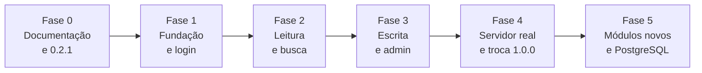

# Roadmap — Intranet FCECON

Última atualização: 26/10/2026. Decisão que originou este roteiro: [ADR 0008](decisoes/0008-laravel-e-nextjs-em-fatias.md). Quadro de tarefas: [kanban.md](kanban.md). Processo e plano de sprints: [scrum.md](scrum.md). Como as duas pilhas convivem: [transicao.md](transicao.md). Critério de aposentadoria dos testes antigos: [matriz-de-paridade.md](matriz-de-paridade.md).

## Em uma frase

Trocar, **em fatias e sem derrubar o sistema**, o PHP puro por **Laravel 13 (API) + Next.js 16 (front estático)**, endurecendo o login no caminho e entregando em seguida os módulos novos (mural de avisos, versões de arquivo, link temporário). A busca global entra na Fase 2, por ser só leitura.

## Onde estamos

| Item | Estado |
|---|---|
| Release no ar | 0.2.0 (árvore de pastas, mover/arrastar, permissões por pasta) |
| Testes | 257 automatizados verdes (189 PHP, incluindo 7 `todo`, mais 75 JS/acessibilidade), cobertura de linhas 96,0 %, PHPStan nível 5 |
| Correção pendente de release | 0.2.1: renomear/apagar pasta com acento ou com caixa diferente perdia a regra de acesso ([commit `3e9d9a4`](estrategia-de-testes.md), defeitos 16 e 17) |
| Fase corrente | **Fase 0** (documentação) |

## Visão geral das fases

Cada fase termina com o sistema funcionando; dá para parar depois de qualquer uma. O legado só sai do ar na Fase 4.

| Fase | Release | Entrega | Pronto quando | Esforço* |
|---|---|---|---|---|
| **0. Documentação** | 0.2.1 | Correção de caixa/UTF-8 nas regras de pasta; ADR 0008; roadmap; matriz de paridade; convivência das pilhas; kanban | Docs revisados; `php tests/all.php` verde | 0,5 dia |
| **1. Fundação e login** | 0.3.0 | Monorepo `api/` (Laravel) e `web/` (Next); CI por pasta; migration *baseline*; Sanctum; **login completo** com a Fase 2 da [ADR 0005](decisoes/0005-endurecimento-do-login.md); tela de login no Next | Os 7 cenários da ADR 0005 verdes no Pest; login Next ↔ API com CSRF; CI verde | 1–2 semanas |
| **2. Leitura e busca** | 0.4.0 | API: listar, árvore, download com `Range`, ZIP, acesso por pasta como Policy, **busca global**; Next: lista, árvore, visualizador, busca | Cenários RH, travessia e UTF-8 passam na API; axe sem violações | 2–3 semanas |
| **3. Escrita e admin** | 0.5.0 | Upload, pastas, renomear, mover, lixeira, usuários, grupos, acesso por pasta, logs, backup; eventos de caminho; Next com as telas de escrita e o Painel Master | Matriz de paridade 100 %; concorrência (8 uploads, 2 admins) verde; Playwright para arrastar/soltar | 3–4 semanas |
| **4. Servidor real e troca** | **1.0.0** | Nginx/Apache + php-fpm + HTTPS; `artisan intranet:smoke`; upload de 500 MB; Font Awesome e imagens locais; CSP; piloto em `/novo`; troca de `/`; legado aposentado | Smoke verde no servidor real; piloto de 1–2 semanas sem incidentes | 1–2 semanas + piloto |
| **5. Módulos novos** | 1.1.0 em diante | Mural de avisos → versões de arquivo → link temporário; TOTP para admins; PostgreSQL | Cada módulo com ADR, modelo de ameaças e testes **antes** do código | 2–5 dias cada |

\* Ordem de grandeza para uma pessoa, estimada antes dos primeiros testes de viabilidade; revise ao fim da Fase 1.

Total até a troca (1.0.0): de **2 a 3 meses** só de trabalho de desenvolvimento; em sprints de 2 semanas com cerimônias, folga e piloto, o plano fecha em **9 sprints (Sprints 0 a 8, cerca de 17 semanas)**. Ver [scrum.md](scrum.md).

## Regras de trabalho (todas as fases)

1. **Teste primeiro:** escreva o teste (no legado, como `todo`; na nova stack, como teste que falha) e só depois o código.
2. **Uma ADR curta por módulo ou decisão estrutural**, com modelo de ameaças quando houver superfície pública.
3. **Pronto =** testes verdes, cobertura ≥ 90 % por arquivo crítico, análise estática (PHPStan 5 no legado; Larastan 6+ e Pint na API; `tsc` e ESLint no front), `smoke` verde, documentação atualizada e roteiro manual no navegador.
4. **Git Flow** ([git-flow.md](git-flow.md)): `feature/*` → PR → `develop` → `release/X.Y.Z` → `main` + tag. Commits em Conventional Commits. Mudanças de segurança entram em release próprio, sem esperar o resto.
5. **Legado congelado:** só correções de segurança (por exemplo, a 0.2.1). Recursos novos e a Fase 2 da ADR 0005 são feitos na nova stack.
6. **Mudança de banco só aditiva** enquanto as duas pilhas escrevem no mesmo SQLite.

## Fase 0 — Documentação e correção 0.2.1

- [x] Corrigir o `LIKE` do SQLite (ignora a caixa) e `strlen` × `substr` (bytes × caracteres) nos prefixos de caminho; 5 testes novos.
- [x] Avaliar PostgreSQL, NestJS, Next.js e Laravel; registrar a decisão ([ADR 0008](decisoes/0008-laravel-e-nextjs-em-fatias.md)).
- [x] Gerar a [matriz de paridade](matriz-de-paridade.md) (189 testes PHP, 44 declarações JS).
- [ ] Este roadmap, [transicao.md](transicao.md) e [kanban.md](kanban.md).
- [ ] Ajustar ADRs 0003, 0004 e 0007, README, pendências e estratégia de testes.
- [ ] Abrir o PR da 0.2.1 e publicar a tag `v0.2.1` (**precisa do seu OK**: envolve push).

## Fase 1 — Fundação e login (0.3.0)

Pré-requisito: instalar **Composer** e **Node 24 LTS** nesta máquina (downloads; precisa de aprovação).

- Monorepo: `api/` (Laravel 13, SQLite no mesmo `storage/database.db`) e `web/` (Next 16, `output: 'export'`, `basePath: '/novo'`).
- CI com um job por pasta: `api/` (Pest, Larastan, Pint) e `web/` (Vitest, `next build`).
- Migration *baseline* que **adota** as tabelas existentes sem recriá-las; SQLite em modo WAL verificado nos dois lados.
- Login por Sanctum (SPA): `POST /api/login`, `POST /api/logout`, `GET /api/me`.
- Endurecimento (a Fase 2 da ADR 0005, feita direto no Laravel):

| Cenário (hoje `todo` em `tests/pending_phase2_test.php`) | No Laravel |
|---|---|
| Limite por IP (31 falhas bloqueiam o IP) | `RateLimiter` com chave por IP |
| Limite por usuário não vira negação de serviço; 25 falhas de IPs diferentes geram `LOGIN_ALERTA` | Contador sem bloqueio + log de alerta |
| Corrida: 30 tentativas simultâneas gravam no máximo 6 falhas | Limitador atômico |
| Trocar a senha derruba as outras sessões | `Auth::logoutOtherDevices` |
| Senha temporária (`must_change_password`) | Coluna + middleware + tela de troca |
| Política de senha (10+, lista de proibidas) | `Password::min(10)` + regra de lista |
| Logins sem diferença de caixa | Índice único em `lower(username)` |

- Mantidos do legado: hash fictício contra enumeração por tempo, log sem texto digitado, teto de sessão de 12 h e ociosidade de 8 h (middleware próprio).

## Fase 2 — Leitura e busca (0.4.0)

- Portar `FileStorage::resolve`, `safeItem`, `cleanName` com os testes de travessia, caixa e UTF-8 **antes** do código.
- `FolderAccess` vira Policy; a regra continua sendo a **interseção na cadeia de ancestrais** ([ADR 0006](decisoes/0006-permissoes-por-pasta.md)).
- Endpoints: listar (com autoria), árvore, download (`Range`, lista de MIME, SVG sempre como anexo), ZIP, **busca global por nome** (poda as pastas fechadas; limite de 200 resultados).
- OpenAPI gerado (Scramble) e tipos TypeScript derivados (`openapi-typescript`).
- Next: lista e migalhas, árvore lateral (teclado e ARIA), visualizador (imagem, PDF, vídeo), busca, tema claro/escuro.

## Fase 3 — Escrita e admin (0.5.0)

- Eventos de caminho (`PathRenamed`, `PathRemoved`) com *listeners* para metadados e regras de acesso; deixa renomear e restaurar atômicos.
- Upload com reserva atômica de nome, mkdir, renomear, mover (modal e arrastar), lixeira (restaura na origem), usuários (último admin protegido por transação), grupos, acesso por pasta, logs.
- Comandos `artisan`: `intranet:backup`, `intranet:restore`, `intranet:create-user`, `intranet:smoke`.
- Next: telas de escrita e Painel Master; Playwright cobre arrastar e soltar e o celular.

## Fase 4 — Servidor real e troca (1.0.0)

Roteiro operacional em [transicao.md](transicao.md): configuração do proxy, piloto, troca, volta atrás.

- `artisan intranet:smoke https://…` verde no servidor real; upload de 500 MB medido fora do `php -S`.
- Font Awesome local, imagens em WebP, CSP com hashes gerados no build.
- Piloto de 1–2 semanas por `/novo`; troca do `/`; legado fora do ar.
- Apagar `senhas-novas.txt` (depois de entregar as senhas) e `_backup_original/`.

## Fase 5 — Módulos novos e PostgreSQL

Ordem, do menor para o maior risco:

1. **Mural de avisos:** `announcements`, `announcement_groups` (reaproveita grupos), `announcement_reads`; texto puro; validade; fixado; botão "Li".
2. **Versões de arquivo:** nova versão no upload de nome repetido; `file_versions` + `storage/versions`; retenção de 5; mover, lixeira e backup levam o histórico por eventos.
3. **Link temporário:** token de 256 bits (guarda só o hash), resposta 404 uniforme, só arquivos, expira em 7 dias (máx. 30), só admin cria, `attachment`, `noindex`, `no-referrer`, auditoria. É o mais sensível, por isso o último.
4. **TOTP para administradores** (nova ADR).
5. **PostgreSQL**, revisitando a [ADR 0007](decisoes/0007-migracao-postgresql.md) com o Laravel (troca por configuração e migrations).

## Riscos

| Risco | Mitigação |
|---|---|
| Duas pilhas escrevendo no mesmo SQLite | WAL, `busy_timeout` alto, mudanças só aditivas, legado congelado, tabelas dos módulos novos só depois da troca |
| Regra de acesso perdida na portagem | Cenários de acesso e os dois defeitos de 26/10 viram testes Pest antes do código |
| Sessão e CSRF entre o Next estático e a API | Mesmo domínio via proxy, Sanctum SPA, teste de ponta a ponta no CI |
| Escopo grande | Fases independentes; pode parar em qualquer uma |
| Servidor real fora do alcance do desenvolvimento | A Fase 4 depende de rodar `intranet:smoke` lá e trazer a saída |
| Atualizações anuais (Laravel, Next, Node, PHP) | Uma janela de atualização por ano; Dependabot ou Renovate no CI |

## Pendências antigas que continuam valendo

Ver [pendencias.md](pendencias.md): docroot em `public/` no servidor real, senhas novas e `_backup_original/`, upload grande fora do `php -S`, navegador real automatizado, Font Awesome local e imagens pesadas.
