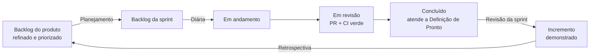

# Scrum — como as fatias viram sprints

Como o [roadmap](roadmap.md) é executado: papéis, cadência, artefatos, estimativa, plano de sprints e definição de pronto. Adaptado a uma equipe pequena (de uma a três pessoas). Quadro de tarefas: [kanban.md](kanban.md).

> **Estado:** processo proposto em 26/10/2026. Os números (pontos, velocidade, duração) são **hipóteses de planejamento** e devem ser recalibrados depois das Sprints 1 e 2.

## 1. Das fatias ao Scrum

| Conceito | Neste projeto |
|---|---|
| **Épico** | Uma fatia do roadmap: E0 Documentação, E1 Fundação e login, E2 Leitura e busca, E3 Escrita e admin, E4 Servidor real e troca, E5 Módulos novos |
| **História / tarefa** | Item `Txxx` do [kanban](kanban.md), com título, pontos e critério de aceitação |
| **Sprint** | 2 semanas; entrega um **incremento** que roda e passa nos testes |
| **Release** | Tag SemVer de [git-flow.md](git-flow.md) ao fim de sprints marcadas no plano (0.3.0, 0.4.0, 0.5.0, **1.0.0**) |
| **Meta da sprint** | Uma frase que diz o que estará de pé no fim; as tarefas servem à meta |
| **Backlog do produto** | Todas as tarefas ainda não planejadas, em ordem de prioridade (o quadro, coluna *Backlog do produto*) |
| **Backlog da sprint** | As tarefas escolhidas no planejamento (coluna *Backlog da sprint*) |

## 2. Papéis

| Papel | Quem | Responsabilidade |
|---|---|---|
| **Product Owner (PO)** | Responsável pelo projeto na FCECON | Ordena o backlog, define a meta de cada sprint, aceita ou recusa o que foi entregue, decide o escopo |
| **Scrum Master (SM)** | Pode ser a mesma pessoa que desenvolve, ou revezar a cada sprint | Cuida do processo: cerimônias, bloqueios, métricas e do respeito ao WIP |
| **Desenvolvedoras e desenvolvedores** | Quem codifica | Estimam, planejam, entregam o incremento e mantêm a Definição de Pronto |
| **Partes interessadas** | TI da instituição (servidor), grupo piloto (3 a 5 pessoas) | Dão retorno na revisão da sprint e no piloto da Sprint 7; a TI libera o servidor |

Com uma só pessoa, ela acumula PO, SM e desenvolvimento; as cerimônias continuam existindo, em versão curta e escrita (ver a seção 3).

## 3. Cadência e cerimônias

Sprint de **2 semanas**, de segunda a sexta da semana seguinte. A Sprint 0 é curta e não tem timebox rígido.

| Cerimônia | Quando | Duração | Saída |
|---|---|---|---|
| **Refinamento** | Quarta da semana 1 | 1 h | Tarefas da próxima sprint com critério de aceitação e pontos (Definição de Preparado) |
| **Planejamento** | Primeira segunda | 1 a 2 h | Meta da sprint e backlog da sprint dentro da capacidade |
| **Reunião diária** | Todo dia útil | 15 min, ou uma linha escrita no quadro | O que fiz, o que farei, o que me trava |
| **Revisão da sprint** | Última sexta | 1 h | Demonstração do incremento rodando; PO aceita ou recusa; backlog ajustado |
| **Retrospectiva** | Logo depois da revisão | 45 min | Até 3 ações de melhoria com responsável, registradas no fim da sprint |

Regras:

- **A sprint é protegida.** Escopo novo vai para o backlog do produto. Exceção: **falha de segurança**, que vira `hotfix/X.Y.Z` do [Git Flow](git-flow.md) fora da sprint e entra como tarefa depois.
- A meta da sprint pode ser renegociada com o PO se ficar inviável; a data não.
- **Limite de trabalho em andamento (WIP):** no máximo 2 tarefas em *Em andamento* e 2 em *Em revisão* por pessoa. Terminar antes de começar.

## 4. Artefatos

| Artefato | Onde |
|---|---|
| Backlog do produto e da sprint | [kanban.md](kanban.md) (retrato) e o artefato "Kanban da Intranet" (quadro vivo) |
| Plano de releases | [roadmap.md](roadmap.md) |
| Incremento | Branch `develop` verde + release em `main` com tag |
| Decisões | [ADRs](decisoes/) |
| Registro das retrospectivas | Seção *Retrospectivas* no fim deste arquivo |

### Definição de Preparado (DoR)

Uma tarefa entra na sprint quando tem:

1. Título no formato "verbo + resultado" e épico.
2. **Critério de aceitação** verificável (ver exemplos na seção 7).
3. Pontos estimados (e quebrada se tiver mais de 8).
4. Dependências conhecidas e resolvidas, ou marcadas na tarefa.
5. Quando mexe em segurança ou superfície pública, o **modelo de ameaças** esboçado na ADR do módulo.

### Definição de Pronto (DoD)

Uma tarefa só vai para *Concluído* quando:

1. Os **testes foram escritos antes** do código e estão verdes (Pest na API, Vitest no front, Playwright onde há layout ou arrastar).
2. Cobertura de linhas ≥ 90 % nos arquivos críticos tocados.
3. Análise estática limpa: Larastan (nível 6 ou mais) e Pint na API; `tsc` e ESLint no front; PHPStan 5 no legado, se o tocar.
4. CI verde no PR e **revisão** de outra pessoa (ou autorrevisão pelo roteiro `/code-review` quando só há uma pessoa, registrada no PR).
5. Acessibilidade: axe sem violações novas e contraste ≥ 4,5:1 em telas alteradas.
6. Segurança: nenhuma regra de acesso, CSRF ou travessia afrouxada; casos de caixa, acento e `RH.`/`RH~1` cobertos quando mexe em caminho.
7. Documentação atualizada ([matriz de paridade](matriz-de-paridade.md), ADR, runbook ou README, conforme o caso) e mudanças de banco **aditivas** enquanto as duas pilhas convivem ([transicao.md](transicao.md)).
8. Demonstrável na revisão da sprint, em ambiente de homologação ou local.

## 5. Estimativa

Pontos de **Fibonacci** (1, 2, 3, 5, 8, 13) medem tamanho relativo, não horas. Referências do projeto:

| Pontos | Exemplo |
|---|---|
| 1 | Ajustar configuração ou publicar tag; um teste com o código já pronto |
| 2 | Um endpoint simples de leitura com teste; um comando `artisan` pequeno |
| 3 | Endpoint com Policy e testes de acesso; tela simples no Next |
| 5 | Regra de segurança nova com vários cenários (limitador de login, upload com nome reservado); tela com acessibilidade e testes |
| 8 | Tela grande com estado (upload com progresso, mover com arrastar); módulo novo ponta a ponta |
| 13 | Grande demais: **quebrar** antes de entrar na sprint (exceção: Versões de arquivo, a quebrar no refinamento da Sprint 9) |

## 6. Capacidade e velocidade

- **Capacidade inicial (hipótese):** cerca de **25 pontos por sprint** para uma pessoa em tempo integral. O plano abaixo foi montado com 17 a 28 pontos por sprint (24 a 28 nas sprints cheias).
- **Recalibrar:** depois das Sprints 1 e 2, use a **média das últimas três sprints** como velocidade; reajuste as sprints futuras e o fim previsto.
- **Folga:** deixe 20 % da capacidade livre para correções, revisão e imprevistos. A Sprint 8 (17 pontos) já é a folga do piloto.
- Com pessoas extras, não multiplique por dois logo de início: some a capacidade só depois de uma sprint de integração.

## 7. Plano de sprints

| Sprint | Fatia | Meta | Pts | Release |
|---|---|---|--:|:-:|
| **0** | E0 | Decisão registrada; plano e documentação publicados; correção de segurança commitada | 14 | 0.2.1 |
| **1** | E1 | Alguém entra pela API a partir do Next, com CI verde e o esquema adotado sem quebrar o legado | 25 | — |
| **2** | E1 | Os 7 cenários da ADR 0005 passam no Laravel e o login do Next está acessível | 27 | **0.3.0** |
| **3** | E2 | A API lista, baixa e compacta respeitando a regra de acesso por pasta | 27 | — |
| **4** | E2 | Navegar, buscar e visualizar pelo Next com acessibilidade verde | 27 | **0.4.0** |
| **5** | E3 | Upload, pastas, mover e lixeira na API, com concorrência testada | 28 | — |
| **6** | E3 | Painel Master e telas de escrita no Next; backup e restauração por artisan | 28 | — |
| **7** | E4 | Smoke verde no servidor real; piloto iniciado em `/novo` | 24 | **0.5.0** |
| **8** | E4 | Troca do `/`, legado aposentado | 17 | **1.0.0** |
| 9 a 12 | E5 | Mural de avisos → Versões → Link temporário → TOTP e PostgreSQL | 8 / 13 / 8 / 19 | 1.1.0 a 1.4.0 |

Pontos totais: **265** (8 já concluídos hoje, de 14 da Sprint 0). Até o 1.0.0: Sprints 0 a 8, cerca de **17 semanas** (4 meses), já com folga e piloto. Isto corrige a estimativa de "2 a 3 meses" do roadmap, que era de uma pessoa sem folga nem cerimônias.

### Riscos por sprint

| Sprint | Risco principal | Plano |
|---|---|---|
| 1 | Aprovação de downloads (Composer, Node); SQLite compartilhado entre as pilhas | Pedir a aprovação no dia 1; testar WAL e `busy_timeout` na própria sprint |
| 2 | Corrida no limitador de login | Testes de concorrência primeiro; limitador atômico |
| 3 | Regra de acesso perdida na portagem | Cenários RH, `RH~1`, acentos e os dois defeitos de 26/10 viram testes antes do código |
| 4 | Acessibilidade e árvore com teclado no React | axe e teste de teclado entram junto de cada componente |
| 5 | Mover/renomear sem dar atomicidade | Eventos de caminho antes das operações |
| 6 | Sprint cheia (28 pts) | Se estourar, Playwright e logs vão para a 7 |
| 7 | Depende do servidor real e de quem o administra | Marcar o pedido à TI na Sprint 5 |
| 8 | Achados do piloto | Folga de 8 pontos já prevista |

## 8. Exemplos de histórias e critérios de aceitação

| Tarefa | História | Critério de aceitação |
|---|---|---|
| T020 | Como administrador, quero que ataques de adivinhação de senha sejam barrados, para proteger as contas | 31 falhas de logins diferentes no mesmo IP bloqueiam o IP; 5 falhas de usuário+IP bloqueiam por 15 min; 30 tentativas simultâneas gravam no máximo 6 falhas |
| T031 | Como usuário sem acesso a RH, não quero ver nem baixar nada de RH, para que a restrição seja real | `RH`, `rh`, `RH.`, `RH~1` e `rh/sub` dão 403 em listar, árvore, download, ZIP e busca; membro do grupo entra |
| T040 | Como usuário, quero buscar por nome em todas as pastas que posso ver, para achar documentos sem navegar | Resultado nunca inclui pasta fechada para mim; limite de 200; acentos e `%`/`_` no termo tratados |
| T053 | Como administrador, quero mover arquivos e pastas, para reorganizar sem perder autoria nem regra de acesso | Destino inválido não move nada; pasta não vai para dentro de si; autoria e regra acompanham; nome ocupado vira `(1)` |
| T082 | Como instituição, quero trocar para a nova versão sem perder dados nem acesso | Smoke verde; volta atrás ensaiada; 30 dias estáveis antes de remover o legado |
| T090 | Como direção, quero publicar comunicados com validade, para a equipe ver na entrada | Aviso expirado some; aviso de grupo só aparece para o grupo; HTML malicioso aparece como texto |

## 9. Métricas

| Métrica | Como medir | Meta |
|---|---|---|
| Velocidade | Pontos concluídos por sprint | Estável (±20 %) a partir da 3ª sprint |
| Burndown da sprint | Pontos restantes por dia | Sem "cauda" na última sexta |
| Defeitos escapados | Bugs achados no piloto ou em produção | 0 de segurança |
| Cobertura | `coverage` do CI | ≥ 90 % nos arquivos críticos |
| Tempo de CI | Duração do workflow | < 10 min |
| Paridade | % da [matriz](matriz-de-paridade.md) com ✅ | 100 % ao fim da Sprint 6 |

## 10. Integração com o Git Flow

- Uma branch por tarefa: `feature/T014-sanctum-login`; commits em Conventional Commits citando o id (`feat(api): login por Sanctum (T014)`).
- PR contra `develop`, com CI verde e revisão, fecha a tarefa no quadro.
- Ao fim das sprints com release (2, 4, 7, 8 e as de módulos): `release/X.Y.Z` → `main` + tag, como em [git-flow.md](git-flow.md).
- Segurança urgente: `hotfix/X.Y.Z` a partir de `main`, sem esperar a sprint.

## Retrospectivas

_Nenhuma ainda. Registre aqui, ao fim de cada sprint: o que funcionou, o que não funcionou, até 3 ações com responsável e prazo._
